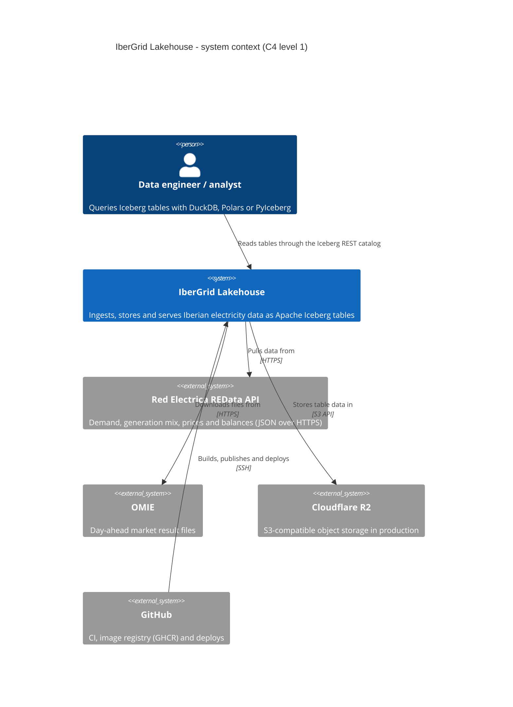

# IberGrid Lakehouse

An open, multi-engine lakehouse for Iberian electricity data: Red Eléctrica's REData API and OMIE
day-ahead market files, stored as Apache Iceberg tables behind a REST catalog and readable from
DuckDB, Polars and PyIceberg without a JVM.

**Status: phase 1 (batch ingestion), in progress.** The stack runs end to end (object storage,
Iceberg REST catalog, broker) with CI/CD around it; the lake library writes Iceberg tables through
Write-Audit-Publish and reads them with DuckDB; and the first connector ingests Red Eléctrica's
REData API (demand, daily generation mix, prices) into `bronze.redata_observations`. Dagster
orchestration and the OMIE connector come next (see [Roadmap](#roadmap)).

## Why

Most of the open lakehouse stack can now run on a laptop and on a single small server:

- **Apache Iceberg** tables give ACID commits, schema evolution and time travel on plain object
  storage, and every major engine reads them.
- A **REST catalog** ([Lakekeeper](https://github.com/lakekeeper/lakekeeper)) decouples the
  engines from storage details, so DuckDB, Polars and PyIceberg can share the same tables.
- The electricity data is public, sub-terabyte and arrives both in batches (daily market files)
  and as frequent updates (system demand, generation mix), which exercises batch and streaming
  ingestion on the same tables.

The choices and the alternatives that were rejected are in
[ADR 0001](docs/adr/0001-stack-and-scope.md).

## Architecture



The container view (C4 level 2), networks and ports are in [docs/architecture.md](docs/architecture.md).

## Quickstart

Requirements: Docker Engine with Compose v2, GNU Make, and [uv](https://docs.astral.sh/uv/) for
the Python tooling.

```bash
make env     # .env with random local secrets (never overwrites an existing one)
make up      # build the app image, start the stack, wait for health checks and one-shots
make smoke   # ibergrid doctor from inside the compose network
```

Then create the lake's tables and ingest a day of REData, from inside the compose network:

```bash
docker compose run --rm --no-deps doctor lake init
docker compose run --rm --no-deps ingest redata --dataset demand_hourly \
  --start 2026-11-20 --end 2026-11-20
```

`make smoke` prints one line per dependency and exits non-zero if any is down:

```text
ok    storage  HeadBucket http://storage:9000/ibergrid (2 ms)
ok    catalog  GET http://catalog:8181/health -> 200 (1 ms)
ok    broker   TCP connect to broker:9092
doctor: all checks passed
```

`make help` lists every target; `make down` stops the stack and `make down-volumes` also deletes
its data.

## Lake

`ibergrid.lake` is the library every pipeline writes and reads through; who does what, the
Write-Audit-Publish protocol and the measured engine capabilities are in
[ADR 0002](docs/adr/0002-iceberg-write-and-read-paths.md).

- **PyIceberg writes.** Tables are declared as `TableSpec`s in `ibergrid.lake.registry` (today
  `bronze.redata_observations`) and created by `ensure_table`, which also adds new optional
  columns and refuses any other change. Every write goes to a run's audit branch
  (`wap.start`, `wap.write`); the audit reads the snapshot `wap.head` (or `wap.read`) returns, and
  `wap.publish(table, run, expected_head)` moves `main` to exactly that snapshot in one guarded
  commit, optionally with table properties such as stream offsets, or raises `PublishConflict`
  and changes nothing.
- **DuckDB reads.** `duck.connect` attaches the catalog as `lake`; `duck.scan` (main or a
  snapshot), `duck.metadata` and `duck.describe` answer from it.
- **Maintenance.** `maintenance.expire_snapshots` (PyIceberg) and
  `maintenance.rewrite_data_files` (DuckDB compaction, which commits to `main`, so runs open
  across it have to restart).

The CLI wraps the table registry and the metadata queries, from inside the compose network:

```bash
docker compose run --rm --no-deps doctor lake init                  # create the registry's tables
docker compose run --rm --no-deps doctor lake describe <ns>.<table> # snapshot, refs, data files
```

## Ingestion

`ibergrid ingest redata` pulls REData into `bronze.redata_observations`, one long table with one
row per point for every widget; [ADR 0003](docs/adr/0003-redata-ingestion.md) has the measured
API limits and the decisions.

| Dataset | REData widget | Points | Electric systems |
|---|---|---|---|
| `demand_realtime` | `demanda/demanda-tiempo-real` | 5 minutes: real, forecast, scheduled | national (the widget's own scope; above the five systems' sum) |
| `demand_hourly` | `demanda/evolucion` | hourly demand | peninsular, canarias, baleares, ceuta, melilla (Canarias' timestamps: see below) |
| `generation_daily` | `generacion/estructura-generacion` | daily generation by technology (REData has no hourly view) | national and the five systems |
| `market_prices` | `mercados/precios-mercados-tiempo-real` | spot price (15 minutes since 2025) and PVPC (hourly) | peninsular |

```bash
docker compose run --rm --no-deps ingest redata --dataset demand_realtime \
  --start 2026-10-01 --end 2026-10-31            # --system <name> (repeatable) narrows it
```

```text
redata: demand_realtime national 2026-10-01..2026-10-31: 35760 rows, 35760/35760 points (100.0 %), snapshot 435293640119925785
redata: 1 chunk(s) published
```

- **Chunks.** Local (Madrid) days, one request and one Write-Audit-Publish run per calendar month
  (per calendar year for daily generation, ending at the last full month: REData answers a long
  daily window that ends mid-month up to the month's end), at most one request a second per
  process, with bounded retries.
- **Idempotent.** Each chunk replaces exactly its dataset, system and UTC window, so a rerun or a
  backfill leaves the same rows. The first failed chunk exits 1; earlier chunks stay published.
- **Checked, not gated.** A structural problem refuses the chunk before anything is written:
  another widget scope than expected, a malformed answer, a value that is not a finite number, a
  repeated key, a point outside the window. Everything else is measured and kept, as Bronze
  should: each line reports expected against received points (DST-aware) with the incomplete
  days, the points that break the dataset's value rule (demand <= 0, prices outside
  -500..4000 EUR/MWh, a share outside 0..1) and the series that were in the window before but
  are missing now; the snapshot summary records the same (`ibergrid.redata.*`). Quality gates
  are phase 4.
- **Raw answers.** Each response body lands at
  `s3://<bucket>/landing/redata/<dataset>/<system>/<YYYY>/<MM>/<start>_<end>-<sha256[:12]>.json`,
  outside the warehouse: one object per window and answer. Every row carries that path and the
  body's SHA-256.
- **Canarias' timestamps are as delivered.** REData stamps every system with peninsular offsets;
  Canarias' load shape suggests Canarian wall-clock times instead, which would put its `ts_utc`
  one hour early. Not verified, so joining Canarias to other systems on `ts_utc` is unsafe for
  now ([ADR 0003](docs/adr/0003-redata-ingestion.md)).
- **Library.** `ibergrid.sources.redata.ingest.ingest(settings, dataset, start, end, systems,
  run_id_prefix)` is what the CLI calls and what the Dagster assets will call.

Clients use their own S3 endpoint and keys (`IBERGRID_S3_*`), so the same code runs from the host
against the published ports, as the integration tests do. Warehouses are created with remote
signing off; one created by an earlier version keeps it on until `make down-volumes && make up`
(local) or `catalog update-credential` (server, see `.env.example`) rewrites the storage-profile
fields this code owns.

## Services

One container per service. Ports are published on 127.0.0.1 only, and only in local development.

| Service | Image | Role | Local port |
|---|---|---|---|
| `storage` | `rustfs/rustfs:1.0.6` | S3-compatible object storage (local profile; Cloudflare R2 in production) | [29000](http://127.0.0.1:29000) S3, [29001](http://127.0.0.1:29001/rustfs/console/) console |
| `storage-init` | `amazon/aws-cli:2.41.2` | One-shot: creates the bucket | |
| `catalog-db` | `postgres:17-alpine` | Lakekeeper's database | |
| `catalog-migrate` | `quay.io/lakekeeper/catalog:v0.15.1` | One-shot: catalog schema migrations | |
| `catalog` | `quay.io/lakekeeper/catalog:v0.15.1` | Iceberg REST catalog and management API | [28181](http://127.0.0.1:28181/health) |
| `catalog-init` | app image (`ibergrid catalog bootstrap`) | One-shot: bootstraps the catalog and creates the warehouse, idempotently | |
| `broker` | `redpandadata/redpanda:v26.2.2` | Kafka API, single node | 29092 Kafka, 29644 admin |
| `doctor` | app image (`ibergrid doctor`) | On demand: readiness report (`make smoke`); also runs `lake` commands | |
| `ingest` | app image (`ibergrid ingest`) | On demand: `ingest redata ...` (384 MiB limit) | |

Every third-party image is pinned by tag and digest in [compose.yaml](compose.yaml).

## Development

```bash
make sync               # install the locked dependencies (uv.lock)
make ci                 # lint, types, unit tests (>= 90 % branch coverage) and repository checks
make test-integration   # against the running stack (make up first)
make test-live          # opt-in: one request per dataset to the live REData API (never in CI)
```

The unit tests run the lake library on PyIceberg's SQL catalog (sqlite and local files), with no
Docker, and replay recorded REData answers (`tests/fixtures/redata`, recorded by
`scripts/record_redata_fixtures.py`) from a local server: they never call the live API. DuckDB downloads its `iceberg`, `httpfs` and `avro` extensions on first use outside the
app image, which bakes them in at build time.

Branches, commits and pull requests follow [CONTRIBUTING.md](CONTRIBUTING.md). Security reports go
through [SECURITY.md](SECURITY.md).

## Deployment

Pushes to `main` publish the app image to `ghcr.io/jaisato/ibergrid-lakehouse`. Tags `v*.*.*`
rerun CI, publish the version and deploy it to a single server over SSH: the job copies
[compose.yaml](compose.yaml) and [compose.prod.yaml](compose.prod.yaml), pins the image digest in
`release.env` (the secrets in `.env` are never rewritten), runs `docker compose up -d --wait` and
then `ibergrid doctor`
([deploy/remote.sh](deploy/remote.sh)). Production storage is Cloudflare R2. The deploy job stays
skipped until the server's variables exist ([deploy/deploy.env.example](deploy/deploy.env.example)).

## Data sources

Every row records its source widget and the update date the publisher reports
(`series_last_update`), and keeps a pointer to the raw answer it came from.

- **Red Eléctrica (REE), REData API** (`apidatos.ree.es`): Spanish electricity system data. REE's
  [API page](https://www.ree.es/es/datos/apidatos) says the API lets third parties "retrieve data
  from the REData widgets and use them for your own purposes"; no licence text for the API was
  found. This project's practice: every dataset and every view of it carries "Source: Red
  Eléctrica, REData" and the update date REE reports.
- **OMIE**, day-ahead market result files: Iberian electricity market data, credited as "Source:
  OMIE" with a link to [omie.es](https://www.omie.es). No licence terms are assumed beyond what
  OMIE publishes on its site.

This project is not affiliated with or endorsed by REE or OMIE.

## Roadmap

Each phase lands as reviewed pull requests; later phases may be reordered as the project evolves.

| Phase | Scope | Status |
|---|---|---|
| 0 | Foundation and risk spike: compose stack, `ibergrid` CLI, CI/CD, docs; the lake library and the measured engine capabilities ([ADR 0002](docs/adr/0002-iceberg-write-and-read-paths.md)) | Done |
| 1 | Batch ingestion: REE REData ([ADR 0003](docs/adr/0003-redata-ingestion.md), done) and OMIE connectors, orchestrated with Dagster (assets, partitions, schedules, backfills) | In progress |
| 2 | Streaming lane: Redpanda producer and consumer, dead-letter queue, deduplication, exactly-once into Bronze | Planned |
| 3 | dbt medallion: Silver and Gold models | Planned |
| 4 | Quality and maintenance: WAP quality gates, quarantine, compaction and snapshot expiry, OpenLineage, data chaos tests | Planned |
| 5 | Benchmarks | Planned |
| 6 | Serving (API and Evidence portal), production on a single server with R2 at `ibergrid-lakehouse.jasato.com`, final README | Planned |

## License

[MIT](LICENSE). The data belongs to its publishers and keeps their terms.
