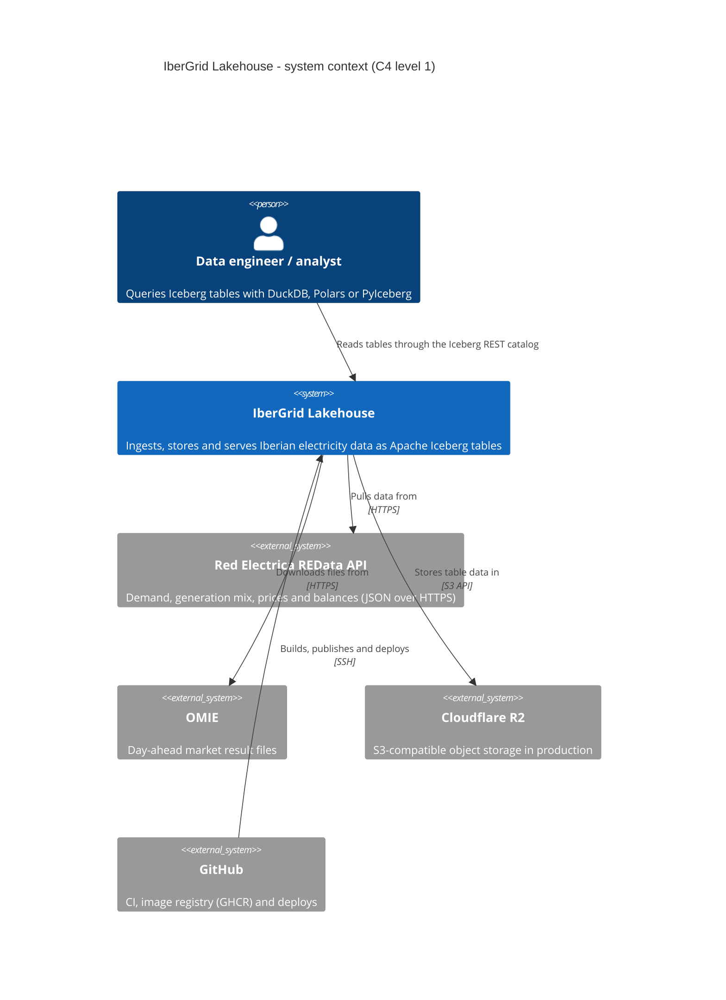

# IberGrid Lakehouse

An open, multi-engine lakehouse for Iberian electricity data: Red Eléctrica's REData API and OMIE
day-ahead market files, stored as Apache Iceberg tables behind a REST catalog and readable from
DuckDB, Polars and PyIceberg without a JVM.

**Status: phase 5 (benchmarks & EU cost analysis) complete.** The stack runs end to end (object
storage, Iceberg REST catalog, broker, Dagster) with CI/CD around it; the lake library writes
Iceberg tables through Write-Audit-Publish and reads them with DuckDB and Polars; two connectors
ingest Red Eléctrica's REData API and OMIE's day-ahead marginal prices into Bronze; Dagster runs
them as partitioned assets with daily schedules, backfills from 2023-01-01, a dead-branch sweeper
and daily automated table maintenance; a streaming lane carries REData's five-minute national demand
through Redpanda (SASL/SCRAM, ACLs) into `bronze.redata_demand_stream`, exactly once; dbt Core +
`dbt-duckdb` builds and tests 5 Silver and 4 Gold medallion Iceberg tables published via PyIceberg
WAP; zero-scan Iceberg metadata checks, declarative Soda v4 contracts (`contracts/soda/*.yml`),
ACID quarantine (`quarantine.rejected_records`), safety-windowed S3 orphan-file cleanup,
OpenLineage v2 events and a reproducible data chaos proof (`make chaos-data`, 5/5 = 100 % WAP
blocking) guard every layer; and a reproducible multi-engine benchmark suite (`make benchmark`)
proves DuckDB 2.0 + Polars 2.1 performance, zero-scan metadata I/O savings and €3.79–€6.49/month
European hosting cost ([ADR 0009](docs/adr/0009-duckdb-polars-vs-spark.md)). Serving (FastAPI +
interactive portal) and production hardening are next (see [Roadmap](#roadmap)).

## Why

Most of the open lakehouse stack can now run on a laptop and on a single small server:

- **Apache Iceberg** tables give ACID commits, schema evolution and time travel on plain object
  storage, and every major engine reads them.
- A **REST catalog** ([Lakekeeper](https://github.com/lakekeeper/lakekeeper)) decouples the
  engines from storage details, so DuckDB, Polars and PyIceberg can share the same tables.
- The electricity data is public, sub-terabyte and arrives both in batches (daily market files)
  and as frequent updates (system demand, generation mix), which exercises batch and streaming
  ingestion on the same tables.

The choices and the alternatives that were rejected are in
[ADR 0001](docs/adr/0001-stack-and-scope.md).

## Architecture



The container view (C4 level 2), networks and ports are in [docs/architecture.md](docs/architecture.md).

## Quickstart

Requirements: Docker Engine with Compose v2, GNU Make, and [uv](https://docs.astral.sh/uv/) for
the Python tooling.

```bash
make env     # .env with random local secrets (never overwrites an existing one)
make up      # build the images, start the stack, wait for health checks and one-shots
make smoke   # ibergrid doctor from inside the compose network
docker compose run --rm --no-deps doctor lake init   # create the lake's tables, once
```

The Dagster UI is at <http://127.0.0.1:28300>: pick an asset of the `bronze` group, choose
partitions (one day, a range, or all of them since 2023-01-01) and materialize them: a range is
one run, the selected REData assets in sequence and OMIE in a run of its own
([Orchestration](#orchestration)). The schedules start stopped locally, so
nothing calls REData or OMIE until you do.

The same ingestion runs from the CLI, from inside the compose network:

```bash
docker compose run --rm --no-deps ingest redata --dataset demand_hourly \
  --start 2026-11-20 --end 2026-11-20
docker compose run --rm --no-deps ingest omie --start 2026-11-20 --end 2026-11-20
```

`make smoke` prints one line per dependency and exits non-zero if any is down:

```text
ok    storage  HeadBucket http://storage:9000/ibergrid (2 ms)
ok    catalog  GET http://catalog:8181/health -> 200 (1 ms)
ok    broker   TCP connect to broker:9092
doctor: all checks passed
```

`make help` lists every target; `make down` stops the stack and `make down-volumes` also deletes
its data.

## Lake

`ibergrid.lake` is the library every pipeline writes and reads through; who does what, the
Write-Audit-Publish protocol and the measured engine capabilities are in
[ADR 0002](docs/adr/0002-iceberg-write-and-read-paths.md).

- **PyIceberg writes.** Tables are declared as `TableSpec`s in `ibergrid.lake.registry` (3 Bronze,
  5 Silver and 4 Gold tables) and created by `ensure_table`, which also adds new optional columns
  and refuses any other change. Every write goes to a run's audit branch
  (`wap.start`, `wap.write`); the audit reads the snapshot `wap.head` (or `wap.read`) returns, and
  `wap.publish(table, run, expected_head)` moves `main` to exactly that snapshot in one guarded
  commit, optionally with table properties such as stream offsets, or raises `PublishConflict`
  and changes nothing.
- **DuckDB reads.** `duck.connect` attaches the catalog as `lake`; `duck.scan` (main or a
  snapshot), `duck.metadata` and `duck.describe` answer from it.
- **Maintenance.** `maintenance.expire_snapshots` (PyIceberg) and
  `maintenance.rewrite_data_files` (DuckDB compaction, which commits to `main`, so runs open
  across it have to restart).

The CLI wraps the table registry and the metadata queries, from inside the compose network:

```bash
docker compose run --rm --no-deps doctor lake init                  # create the registry's tables
docker compose run --rm --no-deps doctor lake describe <ns>.<table> # snapshot, refs, data files
```

## Ingestion

Clients use their own S3 endpoint and keys (`IBERGRID_S3_*`), so the same code runs from the host
against the published ports, as the integration tests do. Warehouses are created with remote
signing off; one created by an earlier version keeps it on until `make down-volumes && make up`
(local) or `catalog update-credential` (server, see `.env.example`) rewrites the storage-profile
fields this code owns.

### REData

`ibergrid ingest redata` pulls REData into `bronze.redata_observations`, one long table with one
row per point for every widget; [ADR 0003](docs/adr/0003-redata-ingestion.md) has the measured
API limits and the decisions.

| Dataset | REData widget | Points | Electric systems |
|---|---|---|---|
| `demand_realtime` | `demanda/demanda-tiempo-real` | 5 minutes: real, forecast, scheduled | national (the widget's own scope; above the five systems' sum) |
| `demand_hourly` | `demanda/evolucion` | hourly demand | peninsular, canarias, baleares, ceuta, melilla (Canarias' timestamps: see below) |
| `generation_daily` | `generacion/estructura-generacion` | daily generation by technology (REData has no hourly view) | national and the five systems |
| `market_prices` | `mercados/precios-mercados-tiempo-real` | spot price (15 minutes since 2025) and PVPC (hourly) | peninsular |

```bash
docker compose run --rm --no-deps ingest redata --dataset demand_realtime \
  --start 2026-10-01 --end 2026-10-31            # --system <name> (repeatable) narrows it
```

```text
redata: demand_realtime national 2026-10-01..2026-10-31: 35760 rows, 35760/35760 points (100.0 %), snapshot 435293640119925785
redata: 1 chunk(s) published
```

- **Chunks.** Local (Madrid) days, one request and one Write-Audit-Publish run per calendar month
  (per calendar year for daily generation, ending at the last full month: REData answers a long
  daily window that ends mid-month up to the month's end), at most one request a second per
  process, with bounded retries.
- **Idempotent.** Each chunk replaces exactly its dataset, system and UTC window, so a rerun or a
  backfill leaves the same rows. The first failed chunk exits 1; earlier chunks stay published.
- **Checked, not gated.** A structural problem refuses the chunk before anything is written:
  another widget scope than expected, a malformed answer, a value that is not a finite number, a
  repeated key, a point outside the window. Everything else is measured and kept, as Bronze
  should: each line reports expected against received points (DST-aware) with the incomplete
  days, the points that break the dataset's value rule (demand <= 0, prices outside
  -500..4000 EUR/MWh, a share outside 0..1) and the series that were in the window before but
  are missing now; the snapshot summary records the same (`ibergrid.redata.*`). Quality gates
  are phase 4.
- **Raw answers.** Each response body lands at
  `s3://<bucket>/landing/redata/<dataset>/<system>/<YYYY>/<MM>/<start>_<end>-<sha256[:12]>.json`,
  outside the warehouse: one object per window and answer content (the hash leaves out
  REData's cache status, which changes between identical answers). Every row carries that path
  and that hash.
- **Canarias' timestamps are as delivered.** REData stamps every system with peninsular offsets;
  Canarias' load shape suggests Canarian wall-clock times instead, which would put its `ts_utc`
  one hour early. Not verified, so joining Canarias to other systems on `ts_utc` is unsafe for
  now ([ADR 0003](docs/adr/0003-redata-ingestion.md)).
- **Library.** `ibergrid.sources.redata.ingest.ingest(settings, dataset, start, end, systems,
  run_id_prefix)` is what the CLI and the Dagster assets call.

### OMIE

`ibergrid ingest omie` downloads OMIE's daily `marginalpdbc` files (day-ahead marginal prices,
MIBEL) into `bronze.omie_day_ahead_prices`, one row per delivery period with Spain's and
Portugal's prices side by side; [ADR 0004](docs/adr/0004-omie-ingestion.md) has the measurements
and the decisions.

```bash
docker compose run --rm --no-deps ingest omie --start 2025-09-25 --end 2025-10-05
```

```text
omie: 2025-09-25..2025-09-30: 6 file(s) (v1 6), 144 rows, snapshot 5117603404312451457
omie: 2025-10-01..2025-10-05: 5 file(s) (v2 5), 480 rows, snapshot 7983525335044605240
omie: 2 chunk(s) published
```

- **Two contract versions.** Hourly periods (23, 24 or 25 a day, v1) for delivery days up to
  2025-09-30, quarter-hours (92, 96 or 100, v2) from 2025-10-01, SDAC's 15-minute market time
  unit. The delivery date picks the version and the period count must match it; the line grammar
  is strict. A file that breaks its contract refuses its chunk before anything is landed or
  written, so a backfill stops at the first such month, and resumes by rerunning.
- **File versions.** A day's file is `marginalpdbc_<YYYYMMDD>.<N>`: `.1` almost always, and a
  republication replaces it under the next number (`20230528.2`, `20251030.3`, `20251127.2` so
  far). The connector asks for `.1`, then `.2` up to `.5`, and takes the first that exists;
  `source_file` and `file_version` record which. A rerun picks up a republished or rewritten
  file; the Dagster schedules re-ingest the last 7 delivery days for that. Daily files start
  on 2023-01-01 (older years are yearly archives, not read).
- **UTC intervals.** `interval_start_utc` is the Madrid midnight of the delivery day plus
  (period - 1) times the resolution, contiguous on every DST day; `resolution_minutes` and
  `contract_version` travel with each row.
- **Chunks and idempotency.** One download per delivery day (at most one a second) and one
  Write-Audit-Publish run per calendar month, replacing exactly its delivery days; the table is
  partitioned by `month(delivery_date)`, so a rerun never touches another month: a whole-month
  rerun replaces that month's files, and a rerun of some days rewrites the files holding them,
  keeping the other days' rows unchanged. Prices outside -500..4000 EUR/MWh are counted per run,
  not refused.
- **Not published yet.** OMIE answers 404 for a file it does not have (every version of a day
  not out yet: five requests). A delivery day after today (Madrid) ends the ingestion there with
  exit 0 (`not published yet from <day>`; the library reports `not_published_from`), after
  writing the days before it, or exit 1 with `--require-published` (then that day's month chunk
  writes nothing; earlier chunks stay published); a missing day up to today is always an error. Results normally appear the afternoon before, around 13:00-14:30 Madrid time.
- **Original files.** Each lands byte for byte at
  `s3://<bucket>/landing/omie/marginalpdbc/<YYYY>/<MM>/marginalpdbc_<YYYYMMDD>-<sha256[:12]>.<N>`;
  every row carries that path and that hash.
- **Library.** `ibergrid.sources.omie.ingest.ingest(settings, start, end, run_id_prefix,
  require_published=False)`.
- **Cross-check.** REData's spot price equals OMIE's Spanish price, and differs from Portugal's
  where the zones decouple, on the recorded days that can tell them apart (2025-04-28 and
  2025-10-01); on days the zones agree it confirms only the timing. Phase 4 turns it into a gate.

## Orchestration

Dagster runs the connectors as assets; [ADR 0005](docs/adr/0005-dagster-orchestration.md) has the
choice against Airflow, the measurements behind the schedules and the decisions.

| Asset | Partitions (Madrid days) | Pool | Schedule (Madrid time) |
|---|---|---|---|
| `bronze/redata_observations/<dataset>`, one per REData dataset | 2023-01-01 to yesterday | `redata` | 09:00, yesterday; re-ingests the 3 days before |
| `bronze/omie_day_ahead_prices` | 2023-01-01 to tomorrow | `omie` | 16:00, tomorrow if out; 21:30, tomorrow required; both re-ingest the last 7 delivery days |
| `silver/*` (5 tables) and `gold/*` (4 tables) via `medallion_models` | Unpartitioned (full refresh) | `transform` | 09:30 and 16:30, after REData and OMIE runs |

- **Backfills are one run per range.** A run hands its whole partition range to one connector
  call, which cuts it into its own chunks (months; years for daily generation), so a backfill of
  any length never becomes one Write-Audit-Publish run per day. Partitions are recorded as their
  chunks publish: a run that fails part way keeps what it published, and rerunning is safe.
- **Each partition records what snapshot expiry would erase**: for REData the day's expected and
  received points per system and each chunk's rule violations, dropped series, snapshot, run id
  and raw answer; for OMIE the chunk's rows, contract versions, out-of-range prices, snapshot and
  run id.
- **One writer per table, one request a second per source.** Each pool has a limit of 1, checked
  before a run is launched; REData and OMIE runs may overlap.
- **Audit branches of dead runs.** Every Write-Audit-Publish run is named after its Dagster run;
  `sweep_audit_branches` (05:30) removes the `audit-*` branches whose run has finished and keeps
  the others.
- **Schedules start stopped** unless `IBERGRID_ORCHESTRATION_SCHEDULES_RUNNING=true`, the
  production default; start them from the UI to try them locally.
- **Failures.** A scheduled run retries a failed step twice, 15 minutes apart; a backfill's
  failed step is not retried. A run that dies without a failed step (its worker killed, then failed
  by the 2-hour runtime limit) is queued again up to twice and redoes its whole range, backfills
  included, so a planned backfill longer than 2 hours gets a higher `dagster/max_runtime_seconds`
  tag or a split range. A failed run shows in the UI, and the trailing windows refill missed days;
  nothing sends notifications yet (phase 6).
- **Runs** execute in `dagster-code`; their metadata, logs and schedule ticks live in
  `orchestration-db` (Postgres), and survive `make down` (not `make down-volumes`).

## Streaming

The streaming lane ([ADR 0006](docs/adr/0006-streaming-lane.md)) polls REData's national
real-time demand (`demanda/demanda-tiempo-real`: Real, Forecasted, Scheduled and Total scheduled,
a point every five minutes) and writes each new or revised point into
`bronze.redata_demand_stream`, once, within about six minutes of REData publishing it (a
five-minute poll, then a flush 60 s after the burst):

- **`stream-producer`** asks REData every five minutes for today (and yesterday, until two hours
  after midnight) through the batch lane's polite client, and emits each point whose content
  changed to `redata.demand.realtime.v1` (key `<series_id>|<ts_utc>`, idempotent producer,
  `acks=all`). Events follow a pydantic contract, committed as a JSON Schema in
  [contracts/redata-demand-realtime.v1.json](contracts/redata-demand-realtime.v1.json).
- **`stream-consumer`** validates every message (failures go to `redata.demand.realtime.dlq.v1`
  with their reason in the headers), drops exact duplicates and keeps revisions, and writes
  micro-batches (at 10,000 rows or 60 s) as Write-Audit-Publish runs whose publish also commits
  the checkpoint (the topic's id and the next offsets) as a table property. On start it seeks to
  the checkpoint in the table, not in the consumer group: a crash anywhere replays from the last
  published batch, so nothing is lost or written twice. A topic that changed under the checkpoint
  (recreated, or a log a crash shortened) stops it until `ibergrid stream reset` says where to
  resume. `make chaos-stream` proves it by SIGKILLing the consumer between the write and the
  publish, between the publish and the group commit, and after a checkpoint-only publish, in a
  throwaway compose project. It expires its table's snapshots daily; a watchdog ends a stuck
  process so that its restart policy recovers it.
- **`broker-init`** (one-shot) turns SASL/SCRAM on for the Kafka listener and authentication on
  for the admin API, disables automatic topic creation, and creates the topics, one user per
  service and their least-privilege ACLs. The broker's unauthenticated HTTP Proxy and Schema
  Registry, unused, do not start.

The stream services are in the `stream` profile locally, so a local stack never calls REData on
its own; production runs them:

```bash
make stream-up       # lake init, then the producer and the consumer (they poll REData)
make stream-status   # the table's rows and checkpoint, the lag per partition, the dead letters
make stream-down     # stop both (the consumer flushes first)
make chaos-stream    # the crash/restart proof, in its own compose project (under two minutes)
# After the topic was recreated (the consumer refuses to start), with the consumer stopped:
docker compose run --rm --no-deps stream-consumer stream reset --to latest   # or --to earliest
```

A consumer that refuses to start is unhealthy at once; `stream reset` refuses a checkpoint that
still fits the topic unless `--force`, and `stream drop-property <name>` removes another group's
checkpoint (or a property an earlier version left) through the same fenced publish.

```text
table:        bronze.redata_demand_stream: 2671 rows, snapshot 4092455876848438779
checkpoint:   ibergrid.stream.checkpoint.redata-demand-to-bronze = {"topic": "redata.demand.realtime.v1", "topic_id": "Zw7KxI8+TgyZmhnNa3ma5g", "epoch": 0, "offsets": {"0": 3772, "1": 3648, "2": 3838}, "timestamps": {"0": 1795274710777, "1": 1795274710777, "2": 1795274710777}}
topic:        redata.demand.realtime.v1 Zw7KxI8+TgyZmhnNa3ma5g
partition 0:  checkpoint 3772, end 3772, lag 0
partition 1:  checkpoint 3648, end 3648, lag 0
partition 2:  checkpoint 3838, end 3838, lag 0
lag:          0 message(s) behind redata.demand.realtime.v1
dead letters: 0 retained in redata.demand.realtime.dlq.v1
```

Two runs against the live API are measured in ADR 0006: 34 minutes with the first version (8
polls, 3,071 events, 1,024 duplicates from a producer restart dropped, 1,020 revisions kept: REE
reprograms the rest of the day every few minutes) and 17 minutes with the final code (4 polls,
1,269 events, 645 duplicates of the first run's points dropped, 591 revisions kept, lag 0). The
batch table stays authoritative for closed days; Silver reconciles the two.

## Medallion transforms (dbt + DuckDB + WAP)

`ibergrid transform run` (`make transform`) and Dagster's `medallion_models` multi-asset build 5
Silver and 4 Gold Iceberg tables with dbt Core (`dbt-core 1.12`) and `dbt-duckdb 1.11`
([ADR 0007](docs/adr/0007-dbt-medallion.md)):

- **Staging DuckDB -> PyIceberg WAP.** A `dbt-duckdb` plugin (`ibergrid.transform.plugin`) reuses
  `ibergrid.lake.duck.configure`, sets `GLOBAL TimeZone = 'UTC'` across all cursors, and exposes
  every Bronze table pinned to its current `main` snapshot (or an empty typed table before the
  first write). `dbt build` runs 12 models and 87 tests (uniqueness, not-null, accepted values,
  DST 23/24/25-hour continuity, peninsular/non-peninsular isolation, Canarias `ts_utc_verified =
  FALSE`, generation total reconciliation, OMIE/REData cross-source spot check and batch+stream
  reconciliation). Any failing test aborts before any Iceberg branch is opened; passing tables are
  aligned to their `TableSpec` schemas and published through `ibergrid.lake.wap`.
- **Silver (`silver.*`):** `demand_national_5min` (batch for closed days + deduplicated stream for
  open days), `demand_system_hourly` (`system_scope` + `ts_utc_verified`), `mibel_prices_period`
  (native 60-min v1 / 15-min v2), `mibel_prices_hourly` (harmonized hourly MIBEL + REData PVPC and
  spot reconciliation) and `generation_daily` (17 verified technologies, excluding `Total
  generation` from technology rows so sums never double-count).
- **Gold (`gold.*`):** `mibel_hourly_market` (peninsular-only market mart with 1-hour ramps,
  intraday rank and renewable shares), `mibel_daily_summary` (peninsular and non-peninsular demand
  kept in separate columns), `system_demand_daily` (all 5 Spanish electric systems) and
  `optimal_consumption_windows` (`month x day_type x hour` load-shifting profile).
- **Measured over 3.9 years (2023-01-01..2026-11-21):** 789,291 rows across 9 tables (14.73 MB
  Parquet) built, tested (87/87) and WAP-published in 25.85 s (`dbt build` 7.84 s; peak RSS
  703 MiB); OMIE Spain vs REData spot reconciles to `0.0 EUR/MWh` across all 34,080 matched hours.

```bash
make transform                                                   # full Silver + Gold rebuild
docker compose run --rm --no-deps transform run --select gold    # build upstreams, publish Gold only
```

## Quality gates, maintenance and OpenLineage

Data quality, storage reclamation and lineage observability follow
[ADR 0008](docs/adr/0008-quality-maintenance-lineage.md):

- **Zero-scan Iceberg metadata checks (`ibergrid.quality.metadata`):** queries DuckDB's
  `iceberg_snapshots`, `iceberg_files` and `iceberg_column_stats` (supporting `snapshot_from_id`
  on WAP audit branches) to validate row counts, non-null columns, typed numeric min/max bounds and
  freshness with **0 Parquet data bytes scanned** (~150 ms per table).
- **Declarative Soda Core v4 contracts (`contracts/soda/*.yml`):** 5 strict schema + domain
  contracts (`bronze_omie_day_ahead_prices`, `bronze_redata_observations`,
  `silver_mibel_prices_hourly`, `silver_demand_system_hourly`, `gold_mibel_hourly_market`) enforce
  MIBEL price limits (`-500..4000 EUR/MWh`), zero duplicate keys, DST 23/24/25-hour continuity,
  strict peninsular/non-peninsular scoping with Canarias `ts_utc_verified = FALSE`, and the
  **cross-source OMIE ES vs REData spot reconciliation gate** (verifying **3,049 real decoupled
  hours** across 2023–2026 to detect ES/PT swaps).
- **ACID quarantine (`quarantine.rejected_records`):** any WAP audit branch failing metadata or
  Soda checks writes offending violations and sampled JSON payloads to `quarantine.rejected_records`
  via WAP and discards the audit branch before `wap.publish` so `main` stays untouched.
- **Automated Iceberg maintenance (`ibergrid.lake.maintenance`):** combines DuckDB compaction,
  PyIceberg `expire_snapshots` (7-day retention, min 5 snapshots, tags and open audit branches
  preserved) and TOCTOU-safe S3 orphan-file cleanup (`remove_orphan_files`, mandatory 48 h safety
  grace window, `--dry-run` supported). Scheduled daily at **04:00 Europe/Madrid** in Dagster
  (`lake_maintenance`).
- **OpenLineage v2 (`ibergrid.lineage`):** emits `START`/`COMPLETE`/`FAIL` RunEvents with dataset
  schemas, Iceberg snapshot ids, output row counts and quality assertions to structured logs plus
  optional JSONL (`IBERGRID_LINEAGE_SINK_PATH`) or HTTP (`IBERGRID_LINEAGE_ENDPOINT_URL`) sinks.

```bash
make quality-check   # zero-scan metadata + Soda v4 contracts across Bronze, Silver and Gold
make maintain        # dry-run compaction, snapshot expiry and S3 orphan-file scan
make chaos-data      # 5-scenario WAP data chaos proof in a throwaway compose project (100 % blocked)
```

## Benchmarks and EU cloud cost

`make benchmark` (`benchmarks/run.py`) runs a non-destructive, reproducible multi-engine benchmark
suite against the live 3.9-year backfilled dataset (`2023-01-01`..`2026-11-21`, 2,546,472 rows,
47.98 MiB Parquet, 229.25 MiB total S3 bucket footprint including raw JSON/OMIE landing) and saves
machine-readable output to [benchmarks/results/latest.json](benchmarks/results/latest.json) and
[docs/benchmarks.md](docs/benchmarks.md). Architectural rationale and Spark crossover thresholds
are documented in [ADR 0009](docs/adr/0009-duckdb-polars-vs-spark.md).

- **Sub-second cold starts & low memory:** DuckDB 2.0.1 starts in **96.8 ms** (`<= 252.9 MiB`
  isolated query RSS) and Polars 2.1.0 in **124.7 ms** (`<= 214.0 MiB` isolated query RSS),
  matching 100 % row-for-row across all 24 `(query, layout, engine)` combinations.
- **Partition pruning & compaction:** on selective monthly queries (`Q1` on 1.69M-row
  `bronze.redata_observations` and `Q3` on 409k-row `silver.demand_national_5min`), Iceberg
  manifest/partition planning reduces the planned Parquet file footprint by **96.5 %–98.7 %**
  (`1/192` files = `421.3 KiB` vs `16.95 MiB` unpartitioned Parquet on `Q1`) before either engine
  opens a Parquet footer; compacting 971 fragmented Bronze files into 192 cuts DuckDB `Q1` p50
  latency by **2.63x** (`29.11 ms -> 11.07 ms`).
- **Zero-scan metadata auditing:** `inspect_table_metadata` verifies row counts, null counts and
  min/max bounds across **all audited columns** of all 12 populated tables with **0 B Parquet data
  scanned** (100 % data-file I/O avoided vs `47.98 MiB` full SQL scans).
- **Real European monthly cost:** `229.25 MiB` stays inside Cloudflare R2's 10 GB free tier
  (**€0.00/month** storage & **$0.00 egress**), pairing with Hetzner Cloud EU CAX11 (**€3.79/mo**)
  or CAX21 (**€6.49/mo**) vs **~€360+/mo** for a managed Spark EU stack (**~55x cheaper**).

```bash
make benchmark       # DuckDB vs Polars storage/engine & zero-scan metadata benchmarks
```

## Services

One container per service. Ports are published on 127.0.0.1 only, and only in local development.

| Service | Image | Role | Local port |
|---|---|---|---|
| `storage` | `rustfs/rustfs:1.0.6` | S3-compatible object storage (local profile; Cloudflare R2 in production) | [29000](http://127.0.0.1:29000) S3, [29001](http://127.0.0.1:29001/rustfs/console/) console |
| `storage-init` | `amazon/aws-cli:2.41.2` | One-shot: creates the bucket | |
| `catalog-db` | `postgres:17-alpine` | Lakekeeper's database | |
| `catalog-migrate` | `quay.io/lakekeeper/catalog:v0.15.1` | One-shot: catalog schema migrations | |
| `catalog` | `quay.io/lakekeeper/catalog:v0.15.1` | Iceberg REST catalog and management API | [28181](http://127.0.0.1:28181/health) |
| `catalog-init` | app image (`ibergrid catalog bootstrap`) | One-shot: bootstraps the catalog and creates the warehouse, idempotently | |
| `broker` | `redpandadata/redpanda:v26.2.2` | Kafka API, single node, SASL/SCRAM and ACLs | 29092 Kafka (SASL/SCRAM); the admin API is not published |
| `broker-init` | `redpandadata/redpanda:v26.2.2` (`rpk`) | One-shot: authentication, topics, users and ACLs, idempotently | |
| `doctor` | app image (`ibergrid doctor`) | On demand: readiness report (`make smoke`); also runs `lake` commands | |
| `ingest` | app image (`ibergrid ingest`) | On demand: `ingest redata ...`, `ingest omie ...` (384 MiB limit) | |
| `transform` | orchestration image (`ibergrid transform`) | On demand: `make transform` (`dbt build` + WAP publish; 1.25 GiB limit) | |
| `quality` | orchestration image (`ibergrid quality`) | On demand: `make quality-check` (Soda v4 + zero-scan metadata) and `make maintain` (1 GiB limit) | |
| `stream-producer` | app image (`ibergrid stream produce`) | REData's real-time demand into the topic (`stream` profile locally) | |
| `stream-consumer` | app image (`ibergrid stream consume`) | The topic into `bronze.redata_demand_stream` (`stream` profile locally) | |
| `orchestration-db` | `postgres:17-alpine` | Dagster's runs, event logs, schedules | |
| `orchestration-migrate` | orchestration image (`dagster instance migrate`) | One-shot: Dagster's schema | |
| `dagster-code` | orchestration image | Dagster code server; runs execute here | |
| `dagster-webserver` | orchestration image | Dagster UI and GraphQL API | [28300](http://127.0.0.1:28300) |
| `dagster-daemon` | orchestration image | Schedules, backfills, run queue and pools, run monitoring | |

Every third-party image is pinned by tag and digest in [compose.yaml](compose.yaml). The app and
orchestration images are two targets of one [Dockerfile](Dockerfile): the orchestration image is
the app plus Dagster, so the app image stays without it.

## Development

```bash
make sync               # install the locked dependencies (uv.lock)
make ci                 # lint, types, unit tests (>= 90 % branch coverage) and repository checks
make test-integration   # against the running stack (make up first); the Dagster tests that
                        # materialize assets run only on a fresh stack and skip on a backfilled one
make test-live          # opt-in: a few requests to the live REData API and omie.es (never in CI)
make chaos-stream       # the streaming lane's crash/restart proof in a throwaway compose project
make contracts          # rewrite contracts/*.json after changing the event model
```

The unit tests run the lake library on PyIceberg's SQL catalog (sqlite and local files), with no
Docker, and replay recorded REData answers and OMIE files (`tests/fixtures/redata` and
`tests/fixtures/omie`, recorded by `scripts/record_redata_fixtures.py` and
`scripts/record_omie_fixtures.py`) from a local server: they never call the live sources. DuckDB downloads its `iceberg`, `httpfs` and `avro` extensions on first use outside the
app image, which bakes them in at build time.

Branches, commits and pull requests follow [CONTRIBUTING.md](CONTRIBUTING.md). Security reports go
through [SECURITY.md](SECURITY.md).

## Deployment

Pushes to `main` publish the app and orchestration images to `ghcr.io/jaisato/ibergrid-lakehouse`
and `ghcr.io/jaisato/ibergrid-lakehouse-orchestration`. Tags `v*.*.*` rerun CI, publish the
version and deploy it to a single server over SSH: the job copies [compose.yaml](compose.yaml) and
[compose.prod.yaml](compose.prod.yaml), pins both image digests in `release.env` (the secrets in
`.env` are never rewritten), creates the lake's tables (`lake init`, idempotent), runs
`docker compose up -d --wait` and then `ibergrid doctor` ([deploy/remote.sh](deploy/remote.sh)).
The Dagster UI publishes no port there: an SSH tunnel to the webserver's internal address serves
it ([deploy/deploy.env.example](deploy/deploy.env.example)). Production storage is Cloudflare R2. The deploy job stays
skipped until the server's variables exist ([deploy/deploy.env.example](deploy/deploy.env.example)).

## Data sources

Every row keeps a pointer to the raw answer or file it came from; REData's rows also record their
widget and the update date REE reports (`series_last_update`).

- **Red Eléctrica (REE), REData API** (`apidatos.ree.es`): Spanish electricity system data. REE's
  [API page](https://www.ree.es/es/datos/apidatos) says the API lets third parties "retrieve data
  from the REData widgets and use them for your own purposes"; no licence text for the API was
  found. This project's practice: every dataset and every view of it carries "Source: Red
  Eléctrica, REData" and the update date REE reports.
- **OMIE**, day-ahead market result files (`marginalpdbc`, the marginal prices for Spain and
  Portugal, downloaded from `www.omie.es`): Iberian electricity market data, credited as "Source:
  OMIE" with a link to [omie.es](https://www.omie.es). No licence terms are assumed beyond what
  OMIE publishes on its site. Every row records the file it came from, its version and its
  SHA-256.

This project is not affiliated with or endorsed by REE or OMIE.

## Roadmap

Each phase lands as reviewed pull requests; later phases may be reordered as the project evolves.

| Phase | Scope | Status |
|---|---|---|
| 0 | Foundation and risk spike: compose stack, `ibergrid` CLI, CI/CD, docs; the lake library and the measured engine capabilities ([ADR 0002](docs/adr/0002-iceberg-write-and-read-paths.md)) | Done |
| 1 | Batch ingestion: REE REData ([ADR 0003](docs/adr/0003-redata-ingestion.md)) and OMIE ([ADR 0004](docs/adr/0004-omie-ingestion.md)) connectors, orchestrated with Dagster: assets, partitions, schedules, backfills ([ADR 0005](docs/adr/0005-dagster-orchestration.md)) | Done |
| 2 | Streaming lane: REData's real-time demand through Redpanda (SASL/SCRAM, ACLs) into `bronze.redata_demand_stream`, exactly once through offsets in the WAP publish, contract, dead-letter topic, deduplication, crash test ([ADR 0006](docs/adr/0006-streaming-lane.md)) | Done |
| 3 | dbt medallion: 5 Silver and 4 Gold Iceberg tables built with dbt Core + `dbt-duckdb`, 87 schema/singular tests, PyIceberg WAP publication, Dagster `@multi_asset` and full 2023-2026 materialization ([ADR 0007](docs/adr/0007-dbt-medallion.md)) | Done |
| 4 | Quality and maintenance: zero-scan Iceberg metadata checks, Soda v4 YAML contracts, ACID quarantine, S3 orphan cleanup + Dagster maintenance, OpenLineage v2, reproducible data chaos proof ([ADR 0008](docs/adr/0008-quality-maintenance-lineage.md)) | Done |
| 5 | Benchmarks: reproducible DuckDB 2.0 vs Polars 2.1 storage/engine & zero-scan metadata suite on 3.9-year dataset, chaos proof summary, EU monthly cost model and DuckDB/Polars vs Spark threshold ([ADR 0009](docs/adr/0009-duckdb-polars-vs-spark.md)) | Done |
| 6 | Serving (API and Evidence portal), production on a single server with R2 at `ibergrid-lakehouse.jasato.com`, final README | Planned |

## License

[MIT](LICENSE). The data belongs to its publishers and keeps their terms.
