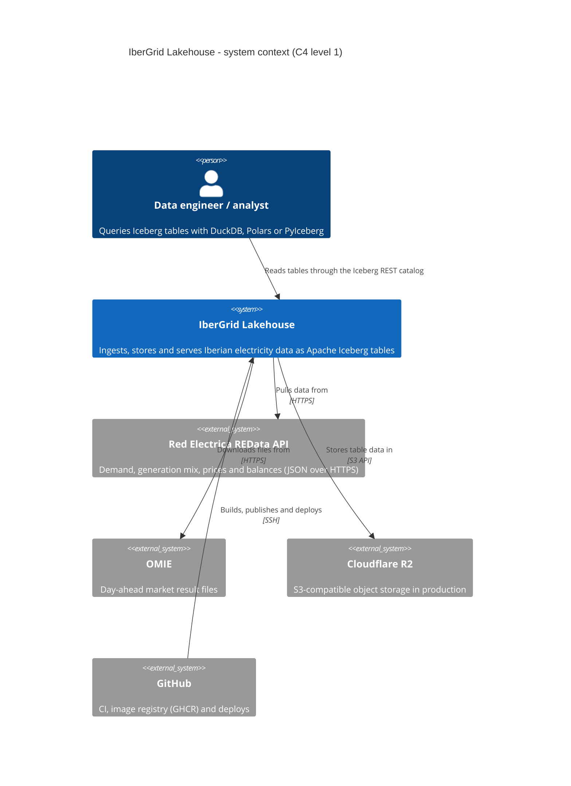

# IberGrid Lakehouse

An open, multi-engine lakehouse for Iberian electricity data: Red Eléctrica's REData API and OMIE
day-ahead market files, stored as Apache Iceberg tables behind a REST catalog and readable from
DuckDB, Polars and PyIceberg without a JVM.

**Status: phase 0 (foundation).** The stack runs end to end (object storage, Iceberg REST catalog,
broker) with CI/CD around it, but no data is ingested yet: connectors arrive in later phases (see
[Roadmap](#roadmap)).

## Why

Most of the open lakehouse stack can now run on a laptop and on a single small server:

- **Apache Iceberg** tables give ACID commits, schema evolution and time travel on plain object
  storage, and every major engine reads them.
- A **REST catalog** ([Lakekeeper](https://github.com/lakekeeper/lakekeeper)) decouples the
  engines from storage details, so DuckDB, Polars and PyIceberg can share the same tables.
- The electricity data is public, sub-terabyte and arrives both in batches (daily market files)
  and as frequent updates (system demand, generation mix), which exercises batch and streaming
  ingestion on the same tables.

The choices and the alternatives that were rejected are in
[ADR 0001](docs/adr/0001-stack-and-scope.md).

## Architecture



The container view (C4 level 2), networks and ports are in [docs/architecture.md](docs/architecture.md).

## Quickstart

Requirements: Docker Engine with Compose v2, GNU Make, and [uv](https://docs.astral.sh/uv/) for
the Python tooling.

```bash
make env     # .env with random local secrets (never overwrites an existing one)
make up      # build the app image, start the stack, wait for health checks and one-shots
make smoke   # ibergrid doctor from inside the compose network
```

`make smoke` prints one line per dependency and exits non-zero if any is down:

```text
ok    storage  HEAD http://storage:9000/ibergrid -> 200 (13 ms)
ok    catalog  GET http://catalog:8181/health -> 200 (1 ms)
ok    broker   TCP connect to broker:9092
doctor: all checks passed
```

`make help` lists every target; `make down` stops the stack and `make down-volumes` also deletes
its data.

## Services

One container per service. Ports are published on 127.0.0.1 only, and only in local development.

| Service | Image | Role | Local port |
|---|---|---|---|
| `storage` | `rustfs/rustfs:1.0.6` | S3-compatible object storage (local profile; Cloudflare R2 in production) | [29000](http://127.0.0.1:29000) S3, [29001](http://127.0.0.1:29001/rustfs/console/) console |
| `storage-init` | `amazon/aws-cli:2.41.2` | One-shot: creates the bucket | |
| `catalog-db` | `postgres:17-alpine` | Lakekeeper's database | |
| `catalog-migrate` | `quay.io/lakekeeper/catalog:v0.15.1` | One-shot: catalog schema migrations | |
| `catalog` | `quay.io/lakekeeper/catalog:v0.15.1` | Iceberg REST catalog and management API | [28181](http://127.0.0.1:28181/health) |
| `catalog-init` | app image (`ibergrid catalog bootstrap`) | One-shot: bootstraps the catalog and creates the warehouse, idempotently | |
| `broker` | `redpandadata/redpanda:v26.2.2` | Kafka API, single node | 29092 Kafka, 29644 admin |
| `doctor` | app image (`ibergrid doctor`) | On demand: readiness report (`make smoke`) | |

Every third-party image is pinned by tag and digest in [compose.yaml](compose.yaml).

## Development

```bash
make sync               # install the locked dependencies (uv.lock)
make ci                 # lint, types, unit tests (>= 90 % branch coverage) and repository checks
make test-integration   # against the running stack (make up first)
```

Branches, commits and pull requests follow [CONTRIBUTING.md](CONTRIBUTING.md). Security reports go
through [SECURITY.md](SECURITY.md).

## Deployment

Pushes to `main` publish the app image to `ghcr.io/jaisato/ibergrid-lakehouse`. Tags `v*.*.*`
rerun CI, publish the version and deploy it to a single server over SSH: the job copies
[compose.yaml](compose.yaml) and [compose.prod.yaml](compose.prod.yaml), pins the image digest in
`release.env` (the secrets in `.env` are never rewritten), runs `docker compose up -d --wait` and
then `ibergrid doctor`
([deploy/remote.sh](deploy/remote.sh)). Production storage is Cloudflare R2. The deploy job stays
skipped until the server's variables exist ([deploy/deploy.env.example](deploy/deploy.env.example)).

## Data sources

No data is downloaded in phase 0. When the connectors land they will record, for every dataset,
its source and the update date the publisher reports.

- **Red Eléctrica (REE), REData API** (`apidatos.ree.es`): Spanish electricity system data. REE's
  [API page](https://www.ree.es/es/datos/apidatos) says the API lets third parties "retrieve data
  from the REData widgets and use them for your own purposes"; no licence text for the API was
  found. This project's practice: every dataset and every view of it carries "Source: Red
  Eléctrica, REData" and the update date REE reports.
- **OMIE**, day-ahead market result files: Iberian electricity market data, credited as "Source:
  OMIE" with a link to [omie.es](https://www.omie.es). No licence terms are assumed beyond what
  OMIE publishes on its site.

This project is not affiliated with or endorsed by REE or OMIE.

## Roadmap

Each phase lands as reviewed pull requests; later phases may be reordered as the project evolves.

| Phase | Scope | Status |
|---|---|---|
| 0 | Foundation: compose stack, `ibergrid` CLI, CI/CD, docs | In progress |
| 1 | Lake library: Iceberg table conventions and I/O with PyIceberg, DuckDB and Polars | Planned |
| 2 | Connectors: REE REData and OMIE ingestion, raw events on Redpanda topics | Planned |
| 3 | Orchestration with Dagster: assets, partitions, schedules, backfills, asset checks | Planned |
| 4 | Streaming: continuous ingestion from Redpanda into Iceberg | Planned |
| 5 | Modelled layers, data quality and table maintenance (compaction, snapshot expiry) | Planned |
| 6 | Production on a single server with R2 and public endpoints at `ibergrid-lakehouse.jasato.com` | Planned |

## License

[MIT](LICENSE). The data belongs to its publishers and keeps their terms.
