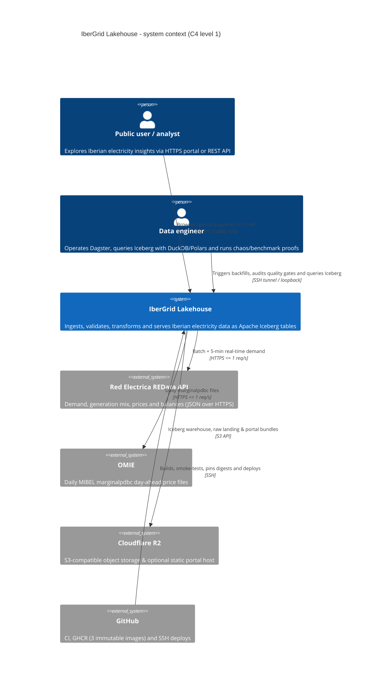
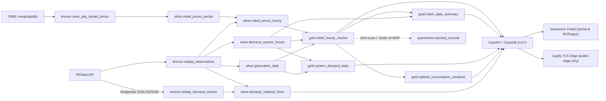

# IberGrid Lakehouse

An open, multi-engine, JVM-free **Apache Iceberg** lakehouse for Iberian electricity data —
ingesting **Red Eléctrica (REData)** and **OMIE (MIBEL)** across batch and streaming lanes,
transforming them through a **dbt Core + DuckDB + Write-Audit-Publish (WAP)** medallion, guarding
every layer with **zero-scan metadata checks + Soda v4 contracts + ACID quarantine**, benchmarking
**DuckDB 2.0 vs Polars 2.1 vs Spark**, and serving insights via a **FastAPI + DuckDB REST API**
and **zero-build interactive analytical portal** for **€3.79–€6.49/month** in Europe.

> **Project status: Complete (Phases 0–6 delivered across 10 ADRs).**
> Verified end-to-end against **3.9 years of live Iberian grid data** (`2023-01-01` to `2026-11-21`).

---

## Executive Snapshot (90-Second Review)

| Metric | Measured Result | Proof / Artifact |
|---|---|---|
| **Live Dataset** | **2,546,472 rows** across 13 Iceberg tables (`1,421` days, `2023-01-01..2026-11-21`) | [portal/data/summary.json](portal/data/summary.json) |
| **Storage Footprint** | **47.98 MiB** Iceberg Parquet (`229.25 MiB` total bucket incl. raw JSON/OMIE landing) | [docs/benchmarks.md](docs/benchmarks.md) |
| **Medallion Build** | **789,291** Silver+Gold rows built, **87/87** dbt tests passed & WAP-published in **25.85 s** | [ADR 0007](docs/adr/0007-dbt-medallion.md) |
| **Cross-Source Reconciliation** | OMIE Spain vs REData spot matches to **0.0 EUR/MWh** across **34,080 hours** (**3,049** decoupled ES/PT hours verified) | [contracts/soda/](contracts/soda/) |
| **Exactly-Once Streaming Proof** | **0 lost, 0 duplicated** across 3 mid-flight `SIGKILL` crash points (`make chaos-stream`) | [ADR 0006](docs/adr/0006-streaming-lane.md) |
| **Data Chaos Gate Proof** | **5/5 (100 %)** corrupt WAP branches blocked before `main` & quarantined (`make chaos-data`) | [ADR 0008](docs/adr/0008-quality-maintenance-lineage.md) |
| **Cold Start & Peak Memory** | DuckDB **96.8 ms** (`<= 252.9 MiB` RSS) · Polars **124.7 ms** (`<= 214.0 MiB` RSS) · **100 %** answer match | [benchmarks/results/latest.json](benchmarks/results/latest.json) |
| **Zero-Scan Metadata Audits** | **0 B Parquet scanned** vs **47.98 MiB** full SQL scans (100 % column-level match on all 12 populated tables) | [ADR 0009](docs/adr/0009-duckdb-polars-vs-spark.md) |
| **EU Monthly Cloud Cost** | **€0.00/mo** Cloudflare R2 (`$0` egress) + **€3.79–€6.49/mo** Hetzner EU ARM64 (**~55x cheaper** than managed Spark) | [docs/benchmarks.md](docs/benchmarks.md) |

---

## Real Iberian Electricity Insights (`2023–2026`)

Queried directly from the Gold Iceberg tables built on real OMIE & Red Eléctrica data:

- **8.7x Explosion of Zero & Negative MIBEL Prices:**

  | Year | Days | Mean ES (€/MWh) | Mean PT (€/MWh) | Hours <= €0/MWh | ES-PT Decoupled Hours | Peninsular Renewable % | Peninsular Solar % |
  |---|---:|---:|---:|---:|---:|---:|---:|
  | **2023** | 365 | 87.10 | 88.27 | **109** | 464 | 52.90 % | 16.73 % |
  | **2024** | 366 | 63.03 | 63.44 | **784** | 547 | 58.86 % | 19.33 % |
  | **2025** | 365 | 65.28 | 66.18 | **797** | 938 | 57.59 % | 20.66 % |
  | **2026 YTD** | 325 | 88.55 | 88.85 | **950** | 1,100 | 58.43 % | 24.74 % |

- **Solar Duck Curve & Intraday Load Shifting (`gold.optimal_consumption_windows`):** on May
  weekdays, the optimal 4-hour midday window (**13:00–16:00 Madrid**) averages
  **€12.81–€16.25/MWh** with **44.9–48.3 %** of hours clearing at or below **€0/MWh**, versus a
  **21:00 evening peak of €94.91/MWh** (**7.4x intraday price spread**, 0 % <= €0/MWh).
- **2025-04-28 Iberian Blackout Captured in Gold (`gold.mibel_daily_summary`):** peninsular daily
  demand fell **-28.0 %** day-over-day (`505,602 MWh` on Apr 27 -> **`364,239 MWh`** on Apr 28 ->
  `550,125 MWh` on Apr 29), alongside 3 ES/PT decoupled hours and 8 zero/negative price hours.
- **Five Separated Spanish Electric Systems (`gold.system_demand_daily`):** peninsular
  (`650.4 GWh/d`, 56.91 % renewable) is never mixed with non-peninsular island/enclave grids —
  Canarias (`24.6 GWh/d`, 20.51 % ren, explicitly flagged `ts_utc_verified = FALSE` per
  [ADR 0003](docs/adr/0003-redata-ingestion.md)), Baleares (`17.2 GWh/d`, 13.87 % ren), Melilla
  (`603.8 MWh/d`, 2.48 % ren) and Ceuta (`545.4 MWh/d`, 0.00 % ren).

---

## Architecture



### Medallion, Quality & Serving Flow



Full C4 Level 2 container diagram, Docker network isolation matrix and service inventory:
[docs/architecture.md](docs/architecture.md).

---

## Quickstart (One-Command Local Stack)

Requirements: Docker Engine with Compose v2, GNU Make and [uv](https://docs.astral.sh/uv/).

```bash
make env                                            # generate random local secrets in .env
make up                                             # build 3 images, start stack, wait until healthy
make smoke                                          # verify RustFS, Lakekeeper and Redpanda from inside compose
docker compose run --rm --no-deps doctor lake init  # create all 13 Iceberg tables (idempotent)
```

Once healthy, everything binds strictly to `127.0.0.1`:

- **Interactive Analytical Portal:** <http://127.0.0.1:28000/portal/>
- **Live FastAPI Swagger / OpenAPI Docs:** <http://127.0.0.1:28000/docs>
- **Dagster Orchestration UI:** <http://127.0.0.1:28300>
- **Lakekeeper Iceberg REST Catalog:** <http://127.0.0.1:28181/health>
- **RustFS Object Storage Console:** <http://127.0.0.1:29001/rustfs/console/>

### Run pipelines, quality gates, proofs & exports

```bash
# Ingest a day of REData + OMIE into Bronze (or trigger backfills from Dagster :28300)
docker compose run --rm --no-deps ingest redata --dataset demand_hourly --start 2026-11-20 --end 2026-11-20
docker compose run --rm --no-deps ingest omie --start 2026-11-20 --end 2026-11-20

# Build, test (87 dbt tests) and WAP-publish Silver & Gold
make transform

# Zero-scan Iceberg metadata checks + Soda v4 contracts + dry-run S3 orphan cleanup
make quality-check
make maintain

# Start/stop live 5-min REData -> Redpanda -> Iceberg streaming lane
make stream-up && make stream-status && make stream-down

# Reproducible proofs & benchmarks
make chaos-stream    # SIGKILL consumer mid-flush in throwaway stack -> 0 lost, 0 duplicated
make chaos-data      # inject 5 corruptions into WAP audit branches -> 5/5 blocked & quarantined
make benchmark       # DuckDB 2.0 vs Polars 2.1, partition pruning, zero-scan metadata & EU cost
make portal-export   # refresh static JSON/CSV portal bundles in portal/data/ (or --s3-prefix portal)

# Stop stack cleanly (preserves volumes; use make down-volumes ONLY to wipe all local data)
make down
```

---

## Serving API & Interactive Portal

The read-only serving layer ([ADR 0010](docs/adr/0010-serving-and-production.md)) queries Iceberg
directly via thread-safe DuckDB (`ibergrid-api` image, 512 MiB memory limit, UID `10001`):

| Endpoint | Source Table | Guardrails & Features |
|---|---|---|
| `GET /health` | DuckDB + Lakekeeper `/health` | Returns `200 ok` / `503 degraded` (works even before `lake init`) |
| `GET /v1/market/hourly` | `gold.mibel_hourly_market` | Bounded `<= 90` days, UTC ISO-8601, ramps, intraday rank, renewable shares |
| `GET /v1/market/daily` | `gold.mibel_daily_summary` | Bounded `<= 1825` days, ES/PT spreads, decoupled & `<= €0` hour counts |
| `GET /v1/systems/daily` | `gold.system_demand_daily` | Preserves `system_scope` and Canarias `ts_utc_verified = false` |
| `GET /v1/windows/optimal` | `gold.optimal_consumption_windows` | Filterable by `month` (`1..12`) and `day_type` (`weekday`/`weekend`) |
| `GET /v1/demand/realtime` | `silver.demand_national_5min` | Trailing `1..168` hours with `batch_points` & `stream_points` provenance |
| `GET /v1/metadata/tables` | Iceberg manifests | Zero-scan inventory across all 13 tables (`total_data_bytes_scanned == 0`) |
| `GET /portal/` | Static HTML/CSS/JS + Chart.js 4.6.1 (SRI) | 5 interactive tabs; works statically on Cloudflare R2/Pages or mounted on FastAPI |

All `/v1/*` routes enforce sliding-window per-IP rate limiting (`X-RateLimit-*`, `429` +
`Retry-After`), explicit CORS origin allowlists, security headers (`nosniff`, `DENY`,
`Referrer-Policy`), short in-process TTL caching and persistent REE/OMIE attribution envelopes.

---

## Benchmarks & EU Cloud Cost Summary

Full methodology, hardware profile, p50/p95/p99 tables and Spark crossover thresholds:
[docs/benchmarks.md](docs/benchmarks.md) and [ADR 0009](docs/adr/0009-duckdb-polars-vs-spark.md).

| Query / Dimension | DuckDB 2.0.1 | Polars 2.1.0 | Spark (JVM Reference) |
|---|---|---|---|
| **Fresh-process cold start** | **96.8 ms** | **124.7 ms** | 15,000–90,000 ms |
| **Isolated query peak RSS (`VmHWM`)** | **213.3–252.9 MiB** | **185.9–214.0 MiB** | 2,048–8,192+ MiB |
| **`Q1` Bronze monthly scan (1.69M rows, Iceberg)** | **11.07 ms** p50 (`1/192` files = `421.3 KiB`) | **14.37 ms** p50 (`100 %` match) | N/A (sub-second unnecessary overhead) |
| **Compaction speedup (`971 -> 192` files on `Q1`)** | **2.63x faster** (`29.11 ms -> 11.07 ms`) | Partition pruning **96.5–98.7 %** footprint cut | — |
| **Zero-scan metadata audit (12 populated tables)** | **0 B Parquet scanned** (100 % column match vs `47.98 MiB`) | — | — |
| **EU Monthly Hosting (47.98 MiB Parquet / 229.25 MiB R2)** | **€3.79–€6.49/mo** (Hetzner CAX11/CAX21 + R2 **€0.00/mo**) | Same single server | ~€360.50/mo managed EU (**~55x** cost) |

---

## Production Deployment & Security Boundary

- **Three immutable GHCR images from one [Dockerfile](Dockerfile):** pushes to `main` and
  `v*.*.*` tags build, smoke-test and push `ibergrid-lakehouse` (lean CLI/ingest/stream),
  `ibergrid-lakehouse-orchestration` (Dagster + dbt + Soda) and `ibergrid-lakehouse-api`
  (FastAPI + Uvicorn + baked portal), pinning all three by `sha256` digest in `release.env` via
  [deploy/remote.sh](deploy/remote.sh) without ever modifying `.env`.
- **Zero exposed internal ports:** Lakekeeper, Redpanda (SASL/SCRAM + least-privilege ACLs),
  Postgres and Dagster publish zero host ports in [compose.prod.yaml](compose.prod.yaml) (Dagster
  UI is accessed via SSH tunnel per [deploy/deploy.env.example](deploy/deploy.env.example)).
- **Optional Caddy HTTPS edge (`profiles: [edge]`):** setting `COMPOSE_PROFILES=edge` and
  `IBERGRID_DOMAIN` starts a pinned, read-only `caddy:2.10.2-alpine` container (`deploy/Caddyfile`)
  on the isolated `public-edge` network with automatic Let's Encrypt TLS, HSTS, strict CSP and
  explicit `403` blocks on `/catalog/*`, `/management/*` and `/graphql*` — able to reach **only**
  `api:8000`. See [SECURITY.md](SECURITY.md).

---

## Architecture Decision Records

| ADR | Decision | Status |
|---|---|---|
| [0001](docs/adr/0001-stack-and-scope.md) | Stack and scope | Accepted |
| [0002](docs/adr/0002-iceberg-write-and-read-paths.md) | Iceberg write and read paths (PyIceberg WAP + DuckDB reads) | Accepted |
| [0003](docs/adr/0003-redata-ingestion.md) | REData ingestion into Bronze (incl. Canarias clock transparency) | Accepted |
| [0004](docs/adr/0004-omie-ingestion.md) | OMIE day-ahead prices into Bronze (v1 hourly / v2 15-min SDAC) | Accepted |
| [0005](docs/adr/0005-dagster-orchestration.md) | Dagster asset-oriented orchestration, pools and backfills | Accepted |
| [0006](docs/adr/0006-streaming-lane.md) | Streaming lane: Redpanda SASL/SCRAM -> Iceberg WAP exactly-once | Accepted |
| [0007](docs/adr/0007-dbt-medallion.md) | Medallion Silver & Gold layers with dbt Core, DuckDB and PyIceberg WAP | Accepted |
| [0008](docs/adr/0008-quality-maintenance-lineage.md) | Zero-scan metadata, Soda v4 gates, quarantine, maintenance & OpenLineage | Accepted |
| [0009](docs/adr/0009-duckdb-polars-vs-spark.md) | DuckDB 2.0 + Polars + PyIceberg vs Apache Spark for sub-TB workloads | Accepted |
| [0010](docs/adr/0010-serving-and-production.md) | FastAPI + DuckDB serving, static portal and Caddy edge security boundary | Accepted |

---

## Development & Verification

```bash
make sync               # install exact locked dependencies (uv.lock)
make ci                 # uv lock --check, ruff, strict mypy, >= 90 % branch coverage,
                        # compose-config (local/prod/edge), hadolint, shellcheck, actionlint, gitleaks
make audit              # pip-audit vulnerability scan across all locked dependency groups
make test-integration   # live stack integration suite (storage, catalog, broker, Dagster, dbt,
                        # quality, benchmarks, FastAPI, static portal & R2/S3 portal export)
make test-live          # opt-in smoke tests against live REData & omie.es (never in CI)
```

Branches, Conventional Commits and pull requests follow [CONTRIBUTING.md](CONTRIBUTING.md).
Vulnerability disclosure policy: [SECURITY.md](SECURITY.md).

---

## Data Sources & Attribution

Every row traces back to its archived raw JSON/OMIE file and SHA-256 digest:

- **Red Eléctrica (REE), REData API** (`apidatos.ree.es`): Spanish electricity system demand,
  generation mix and prices. Every dataset, API response and portal view carries
  *"Source: Red Eléctrica, REData"* and REE's reported update timestamp.
- **OMIE** (`www.omie.es`): Iberian day-ahead marginal market prices (`marginalpdbc`, Spain and
  Portugal), credited as *"Source: OMIE"* with link to [omie.es](https://www.omie.es).

This is a non-commercial open-data engineering portfolio project; it is not affiliated with or
endorsed by Red Eléctrica (REE) or OMIE.

## License

Code and documentation: [MIT](LICENSE). Underlying electricity market data belongs to its
respective publishers and retains their terms.
