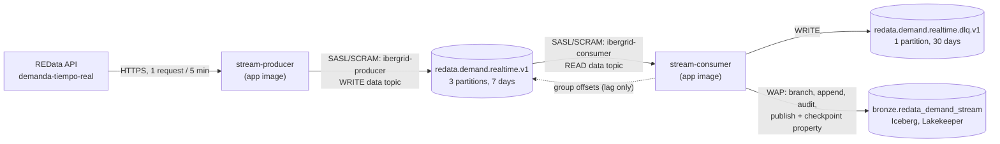

# 0006. Streaming lane: REData real-time demand through Redpanda into Iceberg, exactly once

- Status: accepted
- Date: 2026-11-21

## Context and problem statement

The batch lane ([ADR 0003](0003-redata-ingestion.md), [ADR 0005](0005-dagster-orchestration.md))
loads closed days of REData once a day. Phase 2 adds the lane [ADR 0001](0001-stack-and-scope.md)
planned for frequent updates: REData's national real-time demand, a point every five minutes per
series, visible in the lake minutes after REData publishes it. Redpanda is already in the stack,
unused and unauthenticated (SECURITY.md, "Known gaps"). Four questions need answers:

1. How do events get from REData to Iceberg so that every event lands once in Bronze, across
   crashes, without Kafka transactions (which would not cover the Iceberg commit anyway)?
2. What is the event's contract, what happens to a message that breaks it, and what is a
   duplicate versus a revision?
3. Where do the events land, and how large are the micro-batches, given small files and the cost
   of a checkpoint ([ADR 0002](0002-iceberg-write-and-read-paths.md))?
4. How is the broker secured, in every environment, and how does production differ from a laptop?

## Decision drivers

- Exactly once into Bronze through the one fenced write path there is: `wap.publish(...,
  set_properties=...)` (ADR 0002). No second checkpoint store.
- No JVM and no new service besides the broker that is already there; one container per role.
- Polite to REData: one request per five minutes, through the existing client (at most one
  request a second, bounded retries, its 502 semantics from ADR 0003).
- Bounded small files and catalog commits: idle time must not cost a snapshot every second.
- Least privilege on the broker, the same locally and in production.
- Every claim measured, and pinned by a test where possible.

## Considered options

1. **Broker**: Redpanda (in the stack since phase 0); Apache Kafka in KRaft mode; no broker (the
   producer writes Iceberg itself).
2. **Exactly once**: offsets as table properties in the fenced publish; Kafka transactions
   (read-process-write); offsets in the consumer group with idempotent (upsert) writes.
3. **Target**: a separate append-only stream table; the batch table
   `bronze.redata_observations`.
4. **Client**: confluent-kafka (librdkafka); a pure-Python client (aiokafka, kafka-python).
5. **Image**: the app image for both services; a third image target with the Kafka client only.

## Measurements

Redpanda 26.2.2 (the pinned image), confluent-kafka 2.16.1 with librdkafka 2.16.0, Lakekeeper
0.15.1, PyIceberg 0.12.0, DuckDB 2.0.1; measured on 2026-11-21 in throwaway containers, on the
local stack and in the chaos project. Unless marked †, a result is pinned by
`tests/integration/test_stream.py`, `make chaos-stream` or a unit test.

| What | Result |
|---|---|
| `--mode dev-container` | Bundles `--unsafe-bypass-fsync`, `--check=false`, `--reserve-memory 0M`, and as bootstrap cluster properties `auto_create_topics_enabled: true` and `write_caching_default: true` (`rpk redpanda start --mode help`) † |
| Cluster properties set through the admin API | Survive the container's recreation on the same volume (`auto_create_topics_enabled=false` read back after `docker rm`) † |
| `enable_sasl=true` | Effective at once, no restart: an anonymous `rpk topic list` then fails with "SASL is required but not provided" |
| `admin_api_require_auth=true` | Only a superuser may set it ("May only be set by a superuser"); afterwards anonymous admin calls get 403. `rpk cluster health` (the broker's healthcheck) and `/v1/status/ready` keep answering without credentials † |
| `rpk security user create` on an existing user | Succeeds with the same password, fails with "User already exists" with another; `user update --new-password` then sets it † |
| Idempotent producer (`enable.idempotence`, `acks=all`) with WRITE and DESCRIBE on the topic only | Delivers: no cluster-level IDEMPOTENT_WRITE ACL is needed |
| The consumer's user produces to the data topic; the producer's to the dead-letter topic | `TOPIC_AUTHORIZATION_FAILED` |
| The producer's user consumes | `TOPIC_AUTHORIZATION_FAILED` or `GROUP_AUTHORIZATION_FAILED` |
| A consumer without READ on the group | Fetches, but `commit` fails (`GROUP_AUTHORIZATION_FAILED`) † |
| Anonymous client, wrong password | Refused (no metadata) |
| Producing to a topic that does not exist, as the superuser | Fails; the topic is not created |
| The image's `/etc/redpanda/redpanda.yaml` | Says `developer_mode: true` even without `--mode`; `rpk redpanda mode production` removes it † |
| Production mode with `--memory=1G` in a 1536 MiB container | Refused: "insufficient physical memory: needed 1073741824 available 500000000"; with `--reserve-memory=0M` it starts, 68 MiB at idle, `auto_create_topics_enabled=false`, `write_caching_default=false` † |
| confluent-kafka 2.16.1 | cp312 manylinux_2_28 wheels for x86_64 (4.96 MB) and aarch64 (5.15 MB), librdkafka with SASL/SCRAM built in; 14.6 MB installed † |
| Image sizes | app 790 MB before, 813 MB with confluent-kafka; orchestration 1.04 GB before, 1.06 GB † |
| `ibergrid version` in the app image | 0.86 s of CPU, 133 MiB maximum RSS per start † |
| 120 one-row flushes on Lakekeeper, from the host | 74.5 s (0.62 s each: branch, append, publish); with `commit.manifest-merge.enabled` `main` holds 21 manifests instead of 120, and DuckDB reads all 120 rows † |
| Topic ids (`AdminClient.describe_topics`) | Redpanda returns one per topic, the same on every call, another after the topic is deleted and created again |
| `auto.offset.reset=error`, a fetch at an offset past the end | The consumer gets `_AUTO_OFFSET_RESET` (not fatal) instead of a silent jump to the earliest offset (pinned on the real broker) |
| A topic recreated under a running consumer, refilled past its position | No out-of-range error: the new topic's messages arrive as if the old one went on. The topic-id check before each publish refuses them (pinned on the real broker: no row added) |
| Broker unreachable or password refused while the consumer idles | Review: no error event reaches `consume()` in 12 s; the minute probe (`DescribeTopics`) fails instead (unit-tested with an injected outage) |
| With `auto.offset.reset=earliest` (the first version, and still the second's by mistake) | Review, on the stack: a checkpoint of 5 on a topic back with 3 messages rewrote offsets 0 and 1 (7 rows for 5 messages); a recreated topic refilled past the checkpoint lost 3 events without a warning; a running consumer read a recreated topic and published it under the old topic id. All refused now, pinned by unit and integration tests |
| The image's `pandaproxy: {}` and `schema_registry: {}` | Both listen without authentication (review: an anonymous POST registered a subject that survived a restart); with the two sections deleted before `redpanda start`, ports 8081 and 8082 refuse connections (pinned) |
| SCRAM users through the admin API with `curl` | `POST /v1/security/users` creates (200; 500 "User already exists" with another password), `PUT /v1/security/users/<name>` sets the password (200), a wrong superuser password gets 401 † |
| Default `segment.ms` | 14 days, so at this volume a segment closes, and retention can delete it, 14 days after it opens † |
| Chaos (`make chaos-stream`) | See "Proof" below; about 75 s end to end |
| Live journey on the local stack | See "Live journey" below † |

## Decision outcome

Chosen: **Redpanda, secured with SASL/SCRAM and ACLs in every environment; a `stream-producer`
and a `stream-consumer` service from the app image, on confluent-kafka; a separate append-only
table `bronze.redata_demand_stream`; exactly once through a checkpoint (the topic's id and the
next offsets) committed as a table property in the fenced Write-Audit-Publish commit; duplicates
dropped by key and content hash, revisions kept; a dead-letter topic.**

### The contract

`ibergrid.stream.contract.DemandEvent` (pydantic) is the contract and
`contracts/redata-demand-realtime.v1.json` its JSON Schema; a unit test fails when the committed
file differs from the generated one (`make contracts` rewrites it). An event is one point of one
series: `series_id`, `series_title`, `electric_system` (always `national`), `ts_utc` (UTC, on the
five-minute grid), `ts_local` (as delivered, the same instant), `value` (MW, finite),
`series_last_update`, `content_sha256` and `producer` (name, version, host, `emitted_at`).
`extra` fields are refused. The key is `<series_id>|<ts_utc>` (`2037|2026-11-21T10:05:00Z`), so
every version of a point lands in the same partition, in order; the producer uses Java's
partitioner (`murmur2_random`), so another client would put a key in the same partition.

`content_sha256` hashes `{electric_system, series_id, ts_utc, value}` only. REData's `percentage`
is left out of the event: it is each series' share of the sum of all series at that instant, so
it changes for every series whenever Real gets a new point, and would turn every poll into
revisions of points that did not change. A breaking change of the contract is a new topic
(`.v2`), never an edit of this one.

### The producer

Every 300 s (`IBERGRID_STREAM_POLL_INTERVAL`) the producer asks REData for today, and also for
yesterday until two hours after local midnight (`IBERGRID_STREAM_MIDNIGHT_GRACE`), because the
last points of a day arrive after it: one request for the window, through `RedataClient` and
the batch lane's parser, so the same structural checks refuse a changed answer. It remembers, per
key, the hash it last emitted and emits only points whose hash changed: the first poll of a day
emits about a thousand events, later polls the new Real points and every revision (2 to 390 a
poll in the live journey, most of them the day's programs reprogrammed). The memory is pruned to
the window. It is the process's own: after a restart the whole window goes out again, and the
consumer drops the exact repeats. A point the contract refuses (off the grid, say) is logged and
skipped. A poll that fails is logged and retried at the next tick, whether REData failed (no
answer, its 502, an answer the parser refuses) or the broker did not acknowledge every event
within two minutes (`message.timeout.ms`, delivery `acks=all` with idempotence): unacknowledged
events never count as emitted, so the next poll sends them again, and a broker outage costs one
REData request per five minutes rather than a restart loop.

### The consumer

The checkpoint is the table property `ibergrid.stream.checkpoint.<group>` (the group is
`redata-demand-to-bronze`), a JSON object: the topic, the topic's id, the reset epoch, the next
offset per partition and the Kafka timestamp of the message before it. A Kafka topic id (KIP-516;
Redpanda 26.2 hands it out through `DescribeTopics`, and a deleted and recreated topic of the
same name gets another, measured) tells an offset of this topic from the same number in a topic
recreated under the checkpoint; the timestamp tells it from the same number in a log that lost its
tail and grew back under the same id; the epoch orders rows across a deliberate reset that hands
offsets out again.

On start, the consumer:

1. discards this lane's stale run branches (below);
2. refuses to start when the table holds another group's checkpoint
   (`ibergrid.stream.checkpoint.*`): one table has one writer, and a consumer started with
   another group id would otherwise replay the topic into it from the beginning
   (`--allow-other-checkpoints` for a deliberate migration, then `ibergrid stream drop-property`
   removes the old group's checkpoint through the fenced publish);
3. reads its checkpoint (the table's property, not the consumer group) and refuses to start when
   it names another topic than the one configured, or the topic's id changed (the topic was
   deleted and recreated, so the offsets name other messages);
4. per partition: refuses a checkpoint past the end of the log (the broker lost the tail of its
   log, which dev-container mode makes possible: offsets the checkpoint covers would be handed
   out again to new messages); starts a checkpoint older than the earliest message still there
   at that message, with a `stream.consumer.retention_gap` warning naming the messages lost (the
   batch lane still has those days), and records the jump in its next checkpoint; starts a
   partition without a checkpoint at its earliest message;
5. reads back the message before each checkpointed offset and refuses to start when its timestamp
   is not the recorded one (a lost tail that grew back past the checkpoint before this start;
   recovery is `ibergrid stream reset --to earliest|latest --force`, since the offsets still fit
   the watermarks). If a compacted topic returns a later offset instead of the requested one,
   that partition is skipped with a warning;
6. determines the stream epoch: the checkpoint's when one exists, otherwise `max(stream_epoch) + 1`
   across the table's rows and any other checkpoint properties (0 on an empty table, null rows
   counting as 0), so a force-dropped checkpoint or a consumer group migration never writes rows
   below an earlier reset's epoch;
7. rebuilds the duplicate check from the table: the latest `content_sha256` of every key of the
   last three days (`IBERGRID_STREAM_DEDUP_DAYS`), the latest being the highest
   (`stream_epoch`, `kafka_offset`): within an epoch every version of a key is in the same
   partition, and a reset starts a later epoch;
8. assigns every partition at those offsets (manual assignment, no group rebalancing: one writer
   owns the table).

While it runs, three checks keep the same guarantees. `auto.offset.reset` is `error` (pinned by
the configuration's unit test and by an integration test: assigned past the end, the real broker
answers `_AUTO_OFFSET_RESET` and delivers nothing), so an offset that goes out of range (retention
passing a consumer that fell behind, a topic recreated shorter) starts it again from step 1
instead of a silent jump; so do an authorization or authentication failure and an unknown topic.
A topic recreated — or a log truncated and refilled under the same topic id — past the consumer's
position gives no such error: its messages read as if the old log went on. So before every publish
the consumer compares the topic's id with the checkpoint's AND verifies the previous checkpoint's
log fingerprint (watermarks and read-back of the message before each stored offset, skipping
partitions retention already trimmed, then restoring the consumer's cursor), refusing on a
mismatch with nothing published (pinned on the real broker for topic recreation and in unit tests
for same-topic rewrites). And
every minute it probes the broker the same way: without traffic librdkafka reports neither an
unreachable broker nor a rejected password to the consumer (review measured no error event in
12 s), so the probe is what feeds the failure streak then.

Every refusal leaves the consumer running, unhealthy at once (`refused` in its heartbeat), until an
operator, with the consumer stopped, runs `ibergrid stream reset --to earliest` (write again what
the topic retains) or `--to latest` (skip it). The reset publishes a checkpoint for the topic as it
is now, with an epoch strictly above the table's highest epoch and checkpoint, through the same
fenced publish, so a consumer left running
conflicts instead of interleaving; it refuses a checkpoint that still fits the topic unless
`--force`. `ibergrid stream status` says when the checkpoint is not the topic's.

Each message is validated (pydantic), checked against its key and against the duplicate check:

| Message | Outcome |
|---|---|
| Not JSON, breaks the contract, its key is not the event's, or has no value | To the dead-letter topic, unchanged, with headers `ibergrid.dlq.reason` (`contract`, `key`, `no-value`), `.detail` (pydantic's errors without input values), `.source` (`topic/partition/offset`), `.group`, `.failed-at`; counted |
| Same key and hash as the latest accepted version | Dropped, counted as a duplicate |
| Same key, another hash | Kept, counted as a revision |
| A new key | Kept |

The latest version, not any earlier one, is the reference: a value that goes A, B, A again keeps
the third as a revision, so the latest row per key stays the source's truth. Each row records its
topic id (`kafka_topic_id`) and epoch (`stream_epoch`; rows written before epochs existed count as
0). **Silver's rule**: per key, the highest (`stream_epoch`, `kafka_offset`). Offsets order the
versions of a key only because the key always hashes to the same partition: adding partitions to
the topic moves keys and needs a migration (a new topic, `.v2`, and a reset), never a plain
`alter`.

A flush is one WAP run, `stream-<UTC start to the microsecond>Z-<hex>` (unique per attempt):

1. the dead letters produced so far are flushed and must all be acknowledged; otherwise the
   flush fails;
2. `wap.start`; then **the fence check**: the table's checkpoint at the run's base must still be
   the one this consumer resumed from. `publish` requires `main` at the base, which orders
   publishes from that base on; but a consumer that resumed earlier, while another one published
   from those same offsets, would start its run on top of that publish and land the same messages
   again. Checking the base's checkpoint closes that window (pinned: a second consumer that read
   the same checkpoint raises `PublishConflict`, and one whose rival publishes during its run is
   refused by `main`). The check covers one group: step 2 of the start keeps a second group out;
3. `wap.write` (append) of the buffered rows, with the batch's counts and checkpoint as snapshot
   properties;
4. the audit reads the branch head back, bounded by the batch's instants so planning prunes the
   other months: one row per message of this run, no more;
5. the topic's id is compared with the checkpoint's and the previous checkpoint's log fingerprint
   is verified (above); then
   `wap.publish(..., set_properties={checkpoint property: checkpoint})`: rows and checkpoint land
   in one catalog commit or not at all. A `WapError` (the catalog may have lost its answer) is
   retried twice with the same arguments, which completes the run or resumes from its own
   checkpoint snapshot (ADR 0002); `PublishConflict` is not retried;
6. the offsets go to the consumer group, for `rpk group describe` and `stream status`; a
   failure there costs visibility only.

Any failure discards the open run (best effort) and starts again from step 1 of the start, with
exponential backoff up to 60 s: that one path covers a lost race, a compaction, a catalog or
storage outage, a lost answer, refused dead letters and revoked access. A fatal librdkafka error
stops the process. On SIGTERM the consumer flushes what it buffered (60 s grace) and checkpoints
progress without rows. Once a day it expires its table's snapshots older than three days
(`IBERGRID_STREAM_SNAPSHOT_RETENTION_DAYS`), keeping `main`'s last 50 and the lineage of any
open branch (`maintenance.expire_snapshots`): the table's only writer is the one place that knows
no run of its own is open, and the checkpoint is a table property, which expiry does not touch.
At about 300 snapshots a day, metadata that every flush loads ten times would otherwise grow by
0.2 MB a day. Compaction stays phase 4's.

### Failure modes

| Where it stops | What is in the table | What happens next |
|---|---|---|
| Before `wap.start` | Nothing of the batch | Restart reads from the checkpoint: the batch is read again |
| Between write and publish (SIGKILL) | The batch on `audit-stream-...`; `main` and the checkpoint unchanged | Restart reads it again; the branch is swept once older than `stale_branch_age`, by the start or the loop |
| Between publish and the group commit (SIGKILL) | The batch and its checkpoint | Restart seeks to the table's checkpoint: nothing is read twice; the group catches up at the next flush |
| Right after a checkpoint-only publish (SIGKILL) | The checkpoint past the batch's repeats and dead letters | Restart seeks past them: nothing is read twice, no dead letter repeated |
| After the dead letters, before the publish | Nothing; the dead letters are in their topic | They are produced again on the replay: dead letters are at least once, identifiable by `ibergrid.dlq.source` |
| Lost publish answer | Either landed or not | Published again with the same arguments; if that fails too, restart from the table |
| Second consumer of the same group | One of them publishes | The other's flush conflicts (fence or `main`) and it restarts from the winner's checkpoint |
| A consumer of another group on the same table | Nothing | It refuses to start (`--allow-other-checkpoints` to migrate deliberately) |
| The topic deleted and recreated (another topic id) while the consumer is stopped | Nothing of the new topic | The consumer refuses to start, unhealthy at once; an operator runs `stream reset --to earliest` or `--to latest` |
| The topic deleted and recreated under a running consumer | Nothing of the new topic: an out-of-range error restarts it, or, refilled past its position, the topic-id check before the publish refuses | The next start refuses; `stream reset` |
| The broker lost the tail of a partition (checkpoint past its end) | Nothing of the reused offsets | The consumer refuses to start; `stream reset` |
| The tail was lost and grew back past the checkpoint (stopped or running, same topic id) | Nothing of the rewritten messages | The read-back of the message before the checkpoint (at start and before every publish) finds another timestamp: refuses; `stream reset --force` |
| A reset, force-dropped checkpoint, or group migration on the same topic hands out offsets again | Earlier rows at higher offsets | The next epoch (`max(stream_epoch) + 1`) orders the new rows after them (duplicate check and Silver) |
| The broker unreachable, or the consumer's password refused, while idle | Nothing new | The minute probe fails: a failure streak, unhealthy after 10 minutes |
| Checkpoint older than the retention (7 days), or retention passing a running consumer | Earlier events never arrive | Starts at the earliest message left (after an out-of-range error, through a restart), logs `stream.consumer.retention_gap` with the count; the batch lane covers closed days |
| A message the contract refuses | Not in the table | In the dead-letter topic, with its reason |
| The producer restarts | Nothing new | It re-emits its window; the consumer drops the exact repeats |
| The broker is down for the producer | Nothing new | Each poll fails after two minutes and the next tick sends everything again; unhealthy after 15 minutes |
| A catalog request that never returns (PyIceberg's REST client has no timeout) | Nothing new | The watchdog ends the process after 15 minutes without a loop; the restart policy brings it back |

**Proof** (`make chaos-stream`, a throwaway compose project with its own secrets, volumes and
subnets, removed afterwards; about 75 s): a recorded day (1,152 points) is produced. A consumer
held right after `wap.write` is SIGKILLed: 0 rows in `main`, no checkpoint, one branch left. A
consumer held right after the publish is SIGKILLed: 1,152 rows, the checkpoint at the end of
every partition, no group offsets, the stale branch swept. The producer "restarts" (the same day
again, 1,152 repeats) and a message that is no event arrives; a consumer whose next flush is a
checkpoint (no row) is SIGKILLed right after it: still 1,152 rows, the checkpoint past the repeats
and the dead letter, one dead letter. Then the day again with 7 values revised, and a second day
(300 points); a fourth consumer catches up: 1,459 rows for 3,757 messages (1,459 distinct
messages, 1,459 distinct versions, 1,452 keys), 1,145 duplicates dropped, 7 revisions kept, still
one dead letter, checkpoint and group offsets at the end of every partition, no branch. Unit tests
pin what the chaos settings shorten (the default sweep age, the default duplicate window).

### Stale run branches

A run killed between `wap.start` and its publish or discard leaves `audit-stream-<start>Z-<hex>`.
Iceberg refs carry no creation time (ADR 0002), so the run id carries its start, to the
microsecond. The consumer discards this lane's branches older than `stale_branch_age` (900 s,
far above a flush's few seconds) when it starts and every `stale_branch_age` while it runs, so
the branch of a run killed just before a prompt restart goes within 15 minutes; a branch of a live
run (a misconfigured second consumer, say) is younger and kept. ADR 0005's Dagster sweeper does
not match these names (they are not Dagster run ids) and keeps them.

### Buffer sizing, small files and checkpoint cost

A data flush happens at 10,000 buffered rows (`IBERGRID_STREAM_FLUSH_RECORDS`) or 60 s after the
first one (`IBERGRID_STREAM_FLUSH_AGE`). The producer emits in bursts every five minutes, so 60 s
gathers a whole burst into one flush: at most 288 flushes a day, each one small file (19 KiB on
average in the live journey) in the month's partition. A shorter age would split bursts into more
files without making the data fresher than REData's own five-minute grid; a longer one (15 min:
96 a day) trades freshness for files. The record bound only matters for a replay (a consumer that
was down, a new table reading seven days of retention): 10,000 rows keep a flush's memory small.

Progress without rows (only duplicates or dead letters, as after a producer restart) is
checkpointed at most every 900 s (`IBERGRID_STREAM_CHECKPOINT_INTERVAL`), and never while `main`
holds no data file (ADR 0002: a checkpoint needs live data; the first flush carries rows). Each
checkpoint costs three catalog commits and a snapshot, so checkpointing every idle loop would
write one every second; the price of the bound is re-reading at most 900 s of duplicates after a
crash, which the duplicate check drops again. Nothing happens while the topic is quiet.

288 small appends a day still grow the metadata: the stream table enables
`commit.manifest-merge.enabled` (PyIceberg merges manifests once there are 100; measured: 21
manifests after 120 appends, DuckDB reads them), the consumer expires snapshots daily, and
compaction (phase 4) is mandatory for it. Orphan-file cleanup, also phase 4, is what frees the
storage.

The duplicate check's rebuild at every start reads three days of the table, revisions included.
It streams the scan batch by batch and reduces each batch to one row per key in Arrow, so its
memory follows the keys (about 3,500 for three days), not the rows. Measured on 400,000
synthetic rows in 1,000 files (three days of 4,608 keys) on the SQL catalog: the rebuild adds
75 MiB to the process (peak 223 MiB) where the first version, which turned every row into Python
lists, added 213 to 233 MiB (peak 361 to 381 MiB: the consumer's whole 384 MiB limit; review
measured 360 MiB for 393,000 rows the same way, host RSS on a local SQL catalog); both take about
4 s †.

### The table, and why not the batch table

`bronze.redata_demand_stream` holds one row per accepted event: the event's fields, the Kafka
coordinates (`kafka_topic`, `kafka_topic_id`, `kafka_partition`, `kafka_offset`,
`kafka_timestamp`), `ingested_at` (the flush's) and `run_id` (the flush's WAP run). It is
append-only and partitioned by `month(ts_utc)`, like the batch table: even with its revisions
(tens of thousands of rows a day, 76 bytes a row before compaction) a day partition would be a
file of a few megabytes after compaction, and reads prune by month.

The batch table is the wrong target. Its runs replace whole windows (an overwrite of one dataset,
system and day range per chunk), its audit counts rows per window, and its rows carry a landing
path and a payload hash per chunk; a stream that appends points into it would either be
overwritten by the next batch run of the same day or break the batch audit's "rows outside the
window unchanged". Separate tables keep each lane's invariants: `bronze.redata_observations` stays
authoritative for closed days (REData's settled values, the same series ids), the stream table is
the fresh, append-only record of what was seen when, and Silver (phase 3) reconciles them: the
latest stream version per key (the rule above) for today, the batch values once a day closes.

### Security model

| User | Created by | May | Used by |
|---|---|---|---|
| `ibergrid-admin` | `broker-init` | Everything (superuser) | `broker-init` only |
| `ibergrid-producer` | `broker-init` | WRITE, DESCRIBE `redata.demand.realtime.v1` | `stream-producer` |
| `ibergrid-consumer` | `broker-init` | READ, DESCRIBE `redata.demand.realtime.v1`; WRITE, DESCRIBE `redata.demand.realtime.dlq.v1`; READ, DESCRIBE group `redata-demand-to-bronze` | `stream-consumer`, `stream status`, `stream reset` |

- `broker-init` (the Redpanda image, one-shot, idempotent) creates the superuser, sets
  `superusers`, `admin_api_require_auth`, `enable_sasl`, `auto_create_topics_enabled=false` and
  `write_caching_default=false`, creates the other users (or updates their passwords: rotation),
  the two topics and the ACLs. On a new cluster the admin API needs no authentication until it
  requires it, so the first run creates the superuser anonymously; later runs authenticate as it.
  An existing broker (the local volumes from phase 1, or a server) is hardened in place by the
  next `up`. No password is on a command line: `rpk` reads its credentials from `RPK_*`, and the
  SCRAM users are created through the admin API by `curl`, from a netrc and a JSON body that
  bash's `printf` (a builtin, so no process of its own) writes and the job deletes.
- The topic and group names are defined once in `compose.yaml` (`x-stream-names`), for
  `broker-init` and both services.
- SCRAM-SHA-256 on every Kafka listener, also the one published on `127.0.0.1:29092` locally;
  the admin API (9644) is published nowhere and requires the superuser. The image's
  configuration also starts the HTTP Proxy (8082) and the Schema Registry (8081), without
  authentication (measured: an anonymous POST registered a subject that survived a restart);
  neither is used, so the entrypoint deletes their sections and neither listens (pinned by an
  integration test). The secrets are `REDPANDA_ADMIN_PASSWORD`, `REDPANDA_PRODUCER_PASSWORD` and
  `REDPANDA_CONSUMER_PASSWORD` in `.env` (`make env` generates them; compose refuses to start
  without them).
- The producer gets broker and REData settings only: no storage or catalog keys, and only the
  broker's network. The consumer gets the lake's keys and the broker, catalog and storage
  networks.
- **TLS is not enabled**: SCRAM keeps passwords off the wire, but the traffic itself is plaintext
  inside the compose network. Acceptable while the broker is reachable only on a Docker network
  (and on the host's loopback locally); required before any listener leaves the host.
- The superuser's password cannot rotate through `broker-init`, which authenticates with it:
  change it with `rpk security user update` as the old superuser, then in `.env`.

### Development and production brokers

Locally the broker keeps `--mode dev-container` (fsync bypassed, fast startup), with SASL, ACLs
and no auto-creation all the same: what differs is durability, not security, and the start-up
checks above refuse the log a crash shortened. `compose.prod.yaml` runs it in production mode:
`rpk redpanda mode production` first (the image's own configuration says `developer_mode`), then
`redpanda start` without the bypass, with `--reserve-memory=0M` (the container's 1536 MiB limit
is the reserve) and only the internal listener. `broker-init` sets `write_caching_default=false`
in both, so a server whose cluster was first started in dev-container mode also gets fsync per
write. Both topics roll their segments daily (`segment.ms`): with the default 14-day segments
and this volume, retention would keep data up to 21 days instead of 7 (and 44 instead of 30).

### Health and observability

Each service rewrites a heartbeat file (JSON with its counters, its consecutive failures, when
the streak began and, for the consumer, its last flush) as its loop goes round: the producer
after every poll and every 30 s while waiting, the consumer at most every 5 s. The healthcheck
runs `python -m ibergrid.stream.health` (standard library only) rather than the CLI, whose
133 MiB per start would count against the service's own memory limit every 30 s; `ibergrid stream
health` is the same check for humans. It fails when the heartbeat is older than its limit (330 s
for the producer, whose poll can take four REData attempts of up to 60 s; 120 s for the consumer)
or when the loop has been failing for longer than `--max-failing` (15 minutes for the producer,
10 for the consumer; rows waiting for a flush keep a failure streak open across restarts), and at
once while the consumer refuses to start (`refused`), so a deploy's `up --wait` does not pass a
consumer that will never write. Docker
restarts exited containers, not unhealthy ones, so a watchdog thread ends the process (exit 70)
when the loop has not gone round for `IBERGRID_STREAM_WATCHDOG_TIMEOUT` (900 s): a request that
never returns then becomes a restart. Logs are JSON events: `stream.producer.polled` (window,
points, emitted, suppressed, rejected, seconds), `stream.consumer.flushed` (run id, rows,
duplicates, revisions, dead letters, offsets, lag per partition and total, seconds),
`stream.consumer.dead_letter`, `.retention_gap`, `.failed`, `.checkpoint_reset`,
`stream.watchdog.exit`. `ibergrid stream status` (`make stream-status`) prints the table's rows
and checkpoint, whether the checkpoint is the topic's, the lag per partition (high watermark minus
checkpoint) and the dead letters retained. Compose passes every `IBERGRID_STREAM_*` setting to the
services (`x-stream-env`).

### Upgrading a deployment of the first version

The first version of this lane wrote its checkpoint as `ibergrid.stream.<group>.<topic>.offsets`
under the group `ibergrid.stream.bronze`, without a topic id, and the broker started the HTTP
Proxy and the Schema Registry. An existing deployment (the local stack of phase 2's review was
one) cleans up after `up`, with the stream services stopped:

- `docker compose run --rm --no-deps stream-consumer stream reset --to latest`: adopt the new
  checkpoint (or `--to earliest` to write the retained topic again; repeats inside the duplicate
  window are dropped);
- `... stream drop-property ibergrid.stream.ibergrid.stream.bronze.redata.demand.realtime.v1.offsets`:
  the old property, through the fenced publish;
- as the superuser (`docker compose run --rm --no-deps --entrypoint rpk broker-init ...`):
  `security acl delete --allow-principal User:ibergrid-consumer --operation read,describe --group
  ibergrid.stream.bronze --no-confirm` and `group delete ibergrid.stream.bronze`;
- the Schema Registry's `_schemas` topic is protected by the cluster property
  `kafka_nodelete_topics`: deleting it means taking it off that list first and putting the list
  back afterwards, an operator's decision. Left alone it is one idle partition that nothing
  reads; on the review's local stack it stays.

### One image

Both services run the app image: the consumer needs PyIceberg, pyarrow and DuckDB's catalog
code like any ingestion run, and the producer would save only those in an image of its own,
which the release workflow would build, smoke-test, push and pin on every release. confluent-kafka
adds 23 MB to an image of 790 MB (3 %), so it is a runtime dependency, and the release workflow
and `deploy/remote.sh` stay as they are (the app digest already covers both services).

### Live journey

Two runs on the local stack holding the phase-1 backfill (1.7 M REData rows), against the live
API. **The first ran the first version of this lane** (before the review: checkpoint without
topic id, `auto.offset.reset=earliest`, no probe, no epochs), from 12:07:54 to 12:41:35 UTC on
2026-11-21 (34 minutes):

| Measure | Result |
|---|---|
| Polls | 8, 0.6 to 1.2 s each, none failed, no point rejected |
| Events emitted | 3,071 (1,020 at the first poll, then 2 to 390 a poll; 1,025 after the producer's restart) |
| Flushes | 8, 1.8 to 2.1 s each, lag 0 after every one (also in `rpk group describe`) |
| Rows in `bronze.redata_demand_stream` | 2,047 for 1,027 keys; 2,047 distinct messages; 8 data files, 151 KiB; 9 snapshots |
| Duplicates dropped | 1,024, all from the producer's restart (it re-emitted its window; one point was new) |
| Revisions kept | 1,020: Real 5, Forecasted 289, Scheduled 342, Total scheduled 384; 826 of them for instants still ahead |
| Dead letters | 0 |
| Consumer restart | Resumed at the table's checkpoint with 1,025 keys rebuilt from the table; nothing read twice |
| Against the batch lane | `ingest redata --dataset demand_realtime` for the same day once the stream stopped: all 1,027 keys in both tables, the stream's latest version equal to the batch value for every one |
| Freshness | A Real point reached the table a median 542 s (at most 561 s) after the end of its five minutes: REData's own delay, the poll's phase and the 60 s flush |
| Peak cgroup memory | Producer 94 MiB (limit 256), consumer 128 MiB (limit 384) |

The revisions were the finding: REE reprograms the rest of the day every few minutes, so the
stream writes tens of thousands of rows a day, not the 1,150 points a day has. 21 rows repeat an
earlier version's hash (a value that went back), kept by design (see "The consumer").

**The second ran the final code**, from 15:09:32 to 15:26:15 UTC the same day (17 minutes), on
the same table, after `stream reset --to latest` adopted the new checkpoint and `stream
drop-property` removed the first version's (see "Upgrading a deployment of the first version"):

| Measure | Result |
|---|---|
| Polls | 4, 0.7 to 1.3 s each, none failed, no point rejected |
| Events emitted | 1,269 (1,057 at the first poll of a fresh producer, then 61, 134 and 17) |
| Flushes | 4, 1.7 to 2.6 s each, lag 0 after every one |
| Rows added | 624 (2,671 in the table, 2,671 distinct messages): 33 new points and 591 revisions |
| Duplicates dropped | 645, at the first poll: the points the first run had already written, recognised by the rebuilt duplicate check (1,027 keys at start) |
| Dead letters | 0 |
| Topic probes | One a minute, none failed; no error or warning in the consumer's log |
| Consumer restart | Resumed at the checkpoint after reading back the message before it on all three partitions (timestamps matched), 1,060 keys rebuilt |
| Health | Both healthy throughout; heartbeat `failures 0`, `failing_since null`, `refused null` |
| Against the batch lane | `ingest redata --dataset demand_realtime` right after: 1,060 keys in both; 976 equal; the 84 others are all Scheduled (2053) values for 15:00 to 22:40 UTC, still ahead, which REE reprogrammed between the stream's last poll (15:25:10) and the batch's fetch (15:27:15) |
| Peak cgroup memory | Producer 91 MiB (limit 256), consumer 172 MiB (limit 384) |

## Consequences

- Good: an event lands in Bronze once whatever the crash point, without Kafka transactions and
  without a second store: the checkpoint travels with the data in one fenced commit, and the
  chaos test proves the three kill points.
- Good: a topic that changes under the checkpoint (recreated, or shortened by a crash) stops the
  consumer instead of silently duplicating or skipping; the way forward is one explicit command.
- Good: the broker is authenticated and least-privilege in every environment, nothing on it
  listens without authentication, and a producer container has nothing that reaches the lake.
- Good: duplicates from producer restarts, replays and re-emitted windows cost nothing in the
  table; revisions are kept with their Kafka coordinates, topic id and epoch for Silver.
- Bad: one writer per table: a second consumer of the group only ever wastes work (it conflicts
  and restarts), a consumer of another group refuses to start; scaling out means more tables or a
  partition-aware design, not more consumers. Adding partitions to the topic needs a migration.
- Bad: up to 288 small appends a day, each three catalog commits; the consumer expires snapshots,
  but compaction (phase 4) is mandatory for the stream table, and until orphan-file cleanup exists
  its storage only grows.
- Bad: dead letters are at least once (a crash between producing them and the publish repeats
  them); the duplicate check only reaches back `dedup_days`, so an exact repeat of an older
  point is stored again (Silver deduplicates by key and hash anyway).
- Bad: no TLS on the broker; the superuser's password rotates by hand; a topic reset is an
  operator's decision, not automatic.
- Neutral: the broker's healthcheck relies on `rpk cluster health` answering without credentials,
  as it does on 26.2.2; an upgrade that changes it shows up as an unhealthy broker. The same goes
  for the deleted `pandaproxy` and `schema_registry` sections and the integration test that pins
  them.
- Neutral: the topic's partitions are read at start: partitions added later are only read after a
  restart.

### For the next phases

- **Phase 3, Silver.** `silver` reconciles the lanes: the latest stream version per key (the
  highest (`stream_epoch`, `kafka_offset`)) for days the batch lane has not closed, the batch
  table's value once it has.
- **Phase 4, quality and maintenance.** The audit step of each flush is where quality gates go;
  compaction (when no flush is open: a compaction makes the open flush conflict, and it restarts)
  and orphan-file cleanup are required for this table.
- **Phase 6, production.** TLS on the broker before any listener leaves the host; alerts on
  `stream.consumer.retention_gap`, on a consumer refusing to start, on lag and on dead letters.

## Pros and cons of the other options

### Apache Kafka (KRaft) instead of Redpanda

- Good: the reference implementation; every client and tool targets it.
- Bad: a JVM service with a larger memory floor on a single small server; Redpanda is already in
  the stack, speaks the same protocol, and its SASL/SCRAM and ACLs are the same model.

### No broker: the producer writes Iceberg

- Good: one service fewer.
- Bad: no buffer between REData and the lake (a catalog outage would lose polls or block them),
  no replay, and the lane would teach nothing about streaming; ADR 0001 chose a broker for this.

### Kafka transactions (exactly-once read-process-write)

- Good: the standard answer for Kafka-to-Kafka pipelines.
- Bad: the output is an Iceberg commit, which no Kafka transaction covers: the offsets would
  still have to land with the data in the catalog, which is what the table property does without
  transactions.

### Offsets in the consumer group, idempotent writes

- Good: the usual consumer design; lag tools read it directly.
- Bad: at least once into Iceberg: a crash between the publish and the commit writes the batch
  twice, unless the write is an upsert by key, which an append-only Bronze (with revisions) is
  not, and a merge per flush would rewrite files on every micro-batch.

### Write into `bronze.redata_observations`

- See "The table, and why not the batch table": the batch overwrite and the stream append break
  each other's invariants.

### A pure-Python Kafka client

- Good: no native library.
- Bad: aiokafka is asyncio-only and kafka-python's maintenance is uneven; librdkafka is the client
  Confluent and Redpanda test against, with idempotence and SCRAM built in and wheels for both
  architectures.

### A third image for the stream services

- Good: an ingest image without the Kafka client.
- Bad: 23 MB saved against a third build, smoke test, push and digest pin per release; the
  consumer needs the app image's lake libraries anyway.
