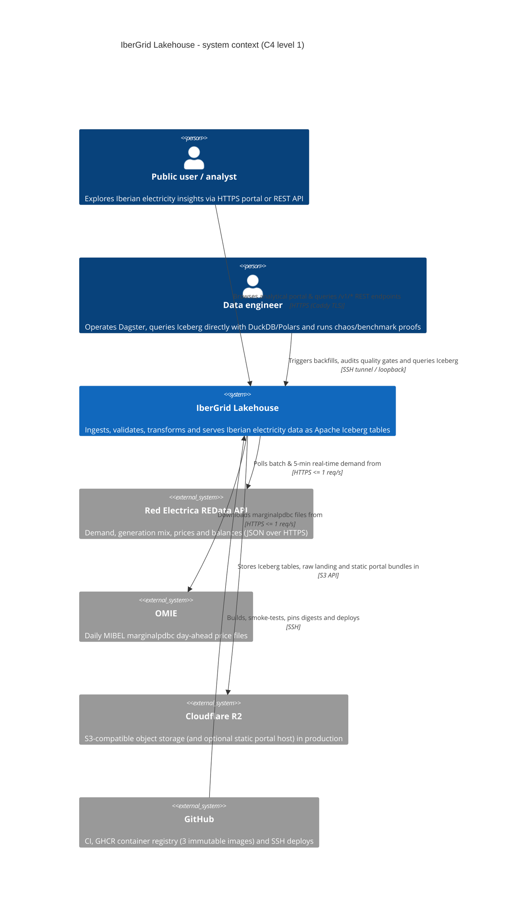
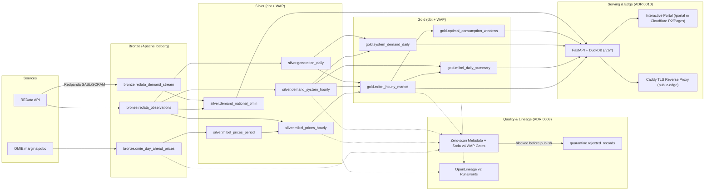

# Architecture

IberGrid Lakehouse is an end-to-end, single-server Apache Iceberg lakehouse for Iberian
electricity data (Red Eléctrica REData API and OMIE MIBEL day-ahead market files). Every layer is
covered by an Architecture Decision Record:

- Stack & scope: [ADR 0001](adr/0001-stack-and-scope.md)
- Iceberg write/read paths & Write-Audit-Publish (WAP): [ADR 0002](adr/0002-iceberg-write-and-read-paths.md)
- Batch connectors (REData & OMIE): [ADR 0003](adr/0003-redata-ingestion.md), [ADR 0004](adr/0004-omie-ingestion.md)
- Asset-oriented orchestration (Dagster): [ADR 0005](adr/0005-dagster-orchestration.md)
- Exactly-once streaming lane (Redpanda SASL/SCRAM + Iceberg WAP): [ADR 0006](adr/0006-streaming-lane.md)
- Medallion Silver & Gold transforms (dbt Core + DuckDB + PyIceberg WAP): [ADR 0007](adr/0007-dbt-medallion.md)
- Quality gates (zero-scan metadata + Soda v4), quarantine, maintenance & OpenLineage v2: [ADR 0008](adr/0008-quality-maintenance-lineage.md)
- Multi-engine benchmarks (DuckDB 2.0 vs Polars 2.1 vs Spark) & EU cost model: [ADR 0009](adr/0009-duckdb-polars-vs-spark.md)
- Serving layer (FastAPI + DuckDB), static analytical portal & Caddy edge security boundary: [ADR 0010](adr/0010-serving-and-production.md)

## System context (C4 level 1)

## Containers (C4 level 2)

```mermaid
C4Container
  title IberGrid Lakehouse - containers (C4 level 2)

  Person(viewer, "Public user / API client")
  Person(engineer, "Data engineer")

  System_Boundary(stack, "Docker Compose project ibergrid") {
    Container(proxy, "proxy (prod edge profile)", "Caddy 2.10.2 Alpine", "Automatic Let's Encrypt TLS (80/443), CSP/HSTS, blocks internal routes; public-edge network only")
    Container(api, "api", "FastAPI + Uvicorn + DuckDB 2.0, api image", "Read-only /v1/* REST API (rate-limited, CORS, TTL cache) + mounted interactive /portal")
    Container(webserver, "dagster-webserver", "Dagster 1.13, orchestration image", "UI and GraphQL API: partitions, runs, backfills, medallion & maintenance lineage")
    Container(daemon, "dagster-daemon", "Dagster 1.13, orchestration image", "Schedules, backfills, run queue with pools of 1, run monitoring")
    Container(code, "dagster-code", "Dagster 1.13, dbt Core, Soda Core, orchestration image", "Code server running Bronze ingestion, dbt+WAP medallion, Soda gates & daily maintenance")
    ContainerDb(orchdb, "orchestration-db", "Postgres 17", "Runs, event logs, schedules (internal network)")
    Container(app, "ibergrid CLI", "Python 3.12, PyIceberg, DuckDB, app image", "catalog-init, doctor, ingest (REData/OMIE), portal export")
    Container(transform, "transform", "dbt Core 1.12, dbt-duckdb 1.11, orchestration image", "On-demand `ibergrid transform run`: staging DuckDB build/test -> PyIceberg WAP")
    Container(quality, "quality", "Soda Core 4.29, DuckDB, orchestration image", "On-demand `ibergrid quality check` and `lake maintain`: metadata gates, Soda v4, quarantine, orphan cleanup")
    Container(catalog, "catalog", "Lakekeeper 0.15.1", "Iceberg REST catalog and management API (internal only in prod)")
    ContainerDb(catalogdb, "catalog-db", "Postgres 17", "Catalog state and encrypted storage credentials (internal network)")
    Container(producer, "stream-producer", "Python 3.12, confluent-kafka, app image", "Polls REData real-time demand every 5 min; emits changed points")
    Container(consumer, "stream-consumer", "Python 3.12, confluent-kafka, PyIceberg, app image", "Validates, deduplicates, dead-letters; WAP micro-batches with offsets in publish")
    Container(broker, "broker", "Redpanda 26.2", "Kafka API with SASL/SCRAM and ACLs: redata.demand.realtime.v1 + DLQ")
    Container(brokerinit, "broker-init", "Redpanda 26.2 (rpk), one-shot", "Authentication, topics, least-privilege users and ACLs")
    ContainerDb(storage, "storage", "RustFS 1.0.6", "S3-compatible bucket, local-storage profile only")
  }

  System_Ext(r2, "Cloudflare R2", "Object storage & optional static portal host in production")
  System_Ext(ree, "Red Electrica REData API", "Public JSON:API, no token")
  System_Ext(omie, "OMIE", "Daily marginalpdbc files, public downloads, no token")

  Rel(viewer, proxy, "HTTPS portal & /v1/* API", "HTTPS 443")
  Rel(proxy, api, "Reverse proxy (public-edge only)", "HTTP 8000")
  Rel(api, catalog, "Read-only Iceberg REST metadata & snapshots", "HTTP")
  Rel(api, storage, "Read-only Parquet scans via DuckDB", "S3 API")
  Rel(engineer, webserver, "Materializes partitions, inspects runs", "SSH tunnel / 127.0.0.1:28300")
  Rel(engineer, catalog, "Direct DuckDB/Polars analytical queries", "127.0.0.1:28181 locally")
  Rel(webserver, code, "Loads definitions, launches runs", "gRPC")
  Rel(daemon, code, "Evaluates schedules, launches queued runs", "gRPC")
  Rel(webserver, orchdb, "Reads and writes", "SQL")
  Rel(daemon, orchdb, "Reads and writes", "SQL")
  Rel(code, orchdb, "Runs write their events", "SQL")
  Rel(code, ree, "REData assets (pool=1, <= 1 req/s)", "HTTPS")
  Rel(code, omie, "OMIE asset (pool=1, <= 1 req/s)", "HTTPS")
  Rel(code, catalog, "Iceberg REST (WAP)", "HTTP")
  Rel(code, storage, "Table data and raw landing", "S3 API")
  Rel(app, ree, "ingest redata", "HTTPS")
  Rel(app, omie, "ingest omie", "HTTPS")
  Rel(app, catalog, "Bootstrap, warehouse, Iceberg REST, /health", "HTTP")
  Rel(app, storage, "Table data, raw landing, portal export", "S3 API")
  Rel(app, broker, "TCP readiness", "Kafka port")
  Rel(transform, catalog, "Reads Bronze snapshots; publishes Silver/Gold via WAP", "HTTP")
  Rel(transform, storage, "Reads Bronze Parquet; writes Silver/Gold Parquet", "S3 API")
  Rel(quality, catalog, "Audits snapshots/branches; writes quarantine; expires snapshots", "HTTP")
  Rel(quality, storage, "Zero-scan manifest reads; Soda checks; orphan cleanup", "S3 API")
  Rel(producer, ree, "demanda-tiempo-real every 5 min", "HTTPS")
  Rel(producer, broker, "Produces events as ibergrid-producer", "Kafka, SASL/SCRAM")
  Rel(consumer, broker, "Consumes; dead letters; group offsets for lag", "Kafka, SASL/SCRAM")
  Rel(consumer, catalog, "Iceberg REST (WAP, offsets as table properties)", "HTTP")
  Rel(consumer, storage, "Table data", "S3 API")
  Rel(brokerinit, broker, "Admin API and Kafka as superuser", "HTTP, Kafka")
  Rel(catalog, catalogdb, "Reads and writes", "SQL")
  Rel(catalog, storage, "Validates and manages warehouse", "S3 API")
  Rel(catalog, r2, "Same role in production", "S3 API")
```

## OpenLineage & serving data flow

## Service inventory

| Container | Image (pinned by digest in `compose.yaml` / `compose.prod.yaml`) | Purpose | Networks | Local ports (127.0.0.1) |
|---|---|---|---|---|
| `storage` | `rustfs/rustfs:1.0.6` | S3 object storage; `local-storage` profile only | storage | 29000 (S3), 29001 (console at `/rustfs/console/`) |
| `storage-init` | `amazon/aws-cli:2.41.2` | One-shot: create bucket idempotently | storage | |
| `catalog-db` | `postgres:17-alpine` | Lakekeeper state; encrypted storage credentials | catalog-db (internal) | |
| `catalog-migrate` | `quay.io/lakekeeper/catalog:v0.15.1` | One-shot: `lakekeeper migrate` | catalog-db | |
| `catalog` | `quay.io/lakekeeper/catalog:v0.15.1` | `lakekeeper serve`: Iceberg REST catalog & management API | catalog-db, catalog, storage | 28181 |
| `catalog-init` | `ibergrid-app` (this repository) | One-shot: `ibergrid catalog bootstrap` | catalog | |
| `broker` | `docker.redpanda.com/redpandadata/redpanda:v26.2.2` | Kafka API, single node; SASL/SCRAM and ACLs | broker | 29092 (Kafka, SASL/SCRAM) |
| `broker-init` | `docker.redpanda.com/redpandadata/redpanda:v26.2.2` | One-shot: SCRAM users, authentication, topics & ACLs | broker | |
| `doctor` | `ibergrid-app` (this repository) | On demand (scale 0): `ibergrid doctor` & `lake` commands | storage, catalog, broker | |
| `ingest` | `ibergrid-app` (this repository) | On demand (scale 0): `ibergrid ingest ...` (384 MiB limit) | storage, catalog | |
| `transform` | `ibergrid-orchestration` (this repository) | On demand (scale 0): `ibergrid transform run` (1.25 GiB limit) | storage, catalog | |
| `quality` | `ibergrid-orchestration` (this repository) | On demand (scale 0): `ibergrid quality check` & `lake maintain` (1 GiB) | storage, catalog | |
| `stream-producer` | `ibergrid-app` (this repository) | `ibergrid stream produce` (`stream` profile locally); no lake keys; 256 MiB | broker | |
| `stream-consumer` | `ibergrid-app` (this repository) | `ibergrid stream consume` (`stream` profile locally); 384 MiB | broker, catalog, storage | |
| `orchestration-db` | `postgres:17-alpine` | Dagster runs, event logs and schedules | orchestration-db (internal) | |
| `orchestration-migrate` | `ibergrid-orchestration` (this repository) | One-shot: `dagster instance migrate` | orchestration-db | |
| `dagster-code` | `ibergrid-orchestration` (this repository) | `dagster code-server start`: definitions & run subprocesses (1.5 GiB) | orchestration, orchestration-db, storage, catalog | |
| `dagster-webserver` | `ibergrid-orchestration` (this repository) | `dagster-webserver`: UI and GraphQL | orchestration, orchestration-db, orchestration-ui (local) | 28300 |
| `dagster-daemon` | `ibergrid-orchestration` (this repository) | `dagster-daemon run`: schedules, backfills, pools, run monitoring | orchestration, orchestration-db | |
| `api` | `ibergrid-api` (this repository) | FastAPI + Uvicorn + DuckDB `/v1/*` REST API & mounted `/portal` (512 MiB) | storage, catalog, public-edge | 28000 |
| `proxy` | `caddy:2.10.2-alpine` (`compose.prod.yaml`, `edge` profile) | Automatic TLS (80/443), HSTS/CSP, blocks internal paths, proxies `api:8000` (128 MiB) | public-edge only | (prod 80/443 when `edge` profile enabled) |

Start-up order comes from `depends_on`: `storage` healthy -> `storage-init`; `catalog-db`
healthy -> `catalog-migrate` -> `catalog` healthy -> `catalog-init` -> `api` healthy (and
`proxy` when the production `edge` profile is enabled); `orchestration-db` healthy ->
`orchestration-migrate`; both init one-shots done -> `dagster-code` healthy -> `dagster-webserver`
and `dagster-daemon`; `broker` healthy -> `broker-init` -> `doctor` and stream services.
`docker compose up --wait` returns once every long-running service is healthy and every one-shot
has exited 0.

## Design notes

- **Least connectivity & public-edge boundary ([ADR 0010](adr/0010-serving-and-production.md)).**
  Each Docker network groups only the services that must talk. Postgres sits on `internal`
  networks with zero egress. In production, internal services (`catalog`, `broker`, `dagster-*`,
  databases) publish **zero host ports**. The optional Caddy `proxy` (`profiles: [edge]`) joins
  **only** `public-edge` alongside `api`: Lakekeeper, Redpanda, Postgres, RustFS and Dagster are
  unreachable at the Docker network layer even if the edge proxy were compromised, and
  `deploy/Caddyfile` also returns `403` on `/catalog/*`, `/management/*` and `/graphql*` as
  defense in depth.
- **Hardening.** Every container, one-shots included, runs with `no-new-privileges`, all
  capabilities dropped (Caddy adds only `NET_BIND_SERVICE` with `read_only: true`), a memory
  limit and a non-root user on all application and data services: RustFS (`10001`), AWS CLI
  (`65534`), Postgres (`70`), Lakekeeper (`65532`), Redpanda (`101`), and `ibergrid-app`,
  `ibergrid-orchestration` and `ibergrid-api` (`10001`).
- **Three images, one Dockerfile.**
  - `ibergrid-app` (~813 MB): lean CLI, ingestion and streaming runtime (no Dagster, dbt, Soda or
    FastAPI).
  - `ibergrid-orchestration` (~1.46 GB): app plus Dagster, dbt Core, `dbt-duckdb`, Soda Core,
    `/opt/ibergrid/dbt` and `/opt/ibergrid/contracts/soda`.
  - `ibergrid-api` (~824 MB): app plus FastAPI, Uvicorn, baked static `portal/` assets
    (`/opt/ibergrid/portal`) and `benchmarks/results/latest.json`.
  In production all three are pulled from GHCR by immutable `sha256` digest pinned in
  `release.env`; the server never builds images.
- **Secrets.** Compose reads required secrets from `.env` with `${VAR:?}` and no defaults. The
  app keeps them in Pydantic `SecretStr` fields and validation errors never echo input values.
- **Lake access ([ADR 0002](adr/0002-iceberg-write-and-read-paths.md)).** PyIceberg writes to
  audit branches and publishes atomically via WAP; DuckDB reads, queries metadata and compacts.
  The Docker images bake DuckDB's `httpfs`, `avro` and `iceberg` extensions at build time.
- **Ingestion & streaming ([ADR 0003](adr/0003-redata-ingestion.md), [ADR 0004](adr/0004-omie-ingestion.md), [ADR 0006](adr/0006-streaming-lane.md)).**
  Batch connectors are chunk-idempotent (`<= 1 req/s`), archive raw bodies under `landing/`, and
  preserve Canarias timestamps transparently (`ts_utc_verified=False`). The streaming lane writes
  REData 5-minute national demand through Redpanda (SASL/SCRAM + least-privilege ACLs) into
  `bronze.redata_demand_stream`, committing Kafka offsets atomically as Iceberg table properties
  on WAP publish (`make chaos-stream` proves 0 lost, 0 duplicated under SIGKILL).
- **Medallion, quality, maintenance & lineage ([ADR 0007](adr/0007-dbt-medallion.md), [ADR 0008](adr/0008-quality-maintenance-lineage.md)).**
  `dbt build` runs 12 models and 87 tests in an ephemeral staging DuckDB pinned to Bronze `main`
  snapshots before PyIceberg WAP publication; zero-scan Iceberg metadata checks (`0 B` Parquet
  scanned) and declarative Soda v4 YAML contracts guard every layer, quarantining rejected rows
  into `quarantine.rejected_records`; daily Dagster maintenance runs compaction, snapshot expiry
  and 48 h-graced S3 orphan-file cleanup; OpenLineage v2 emits structured run lineage.
- **Serving & static portal ([ADR 0010](adr/0010-serving-and-production.md)).**
  FastAPI queries Iceberg directly via thread-safe DuckDB with short TTL caching, bounded date
  ranges, CORS allowlists, security headers and sliding-window per-IP rate limiting.
  `ibergrid portal export` materializes compact JSON/CSV bundles to `portal/data/` and/or S3/R2
  so the zero-build Chart.js portal works identically on Cloudflare R2/Pages and on FastAPI's
  `/portal`.

## Environments

| | Local (`make up`) | Production (`compose.prod.yaml`) |
|---|---|---|
| Object storage | RustFS container (`local-storage` profile) | Cloudflare R2, `https://<account-id>.r2.cloudflarestorage.com`, region `auto` |
| App image | Built from source (`compose.override.yaml`) | `ghcr.io/jaisato/ibergrid-lakehouse@sha256:...`, digest in `release.env` |
| Orchestration image | Built from source (`--target orchestration`) | `ghcr.io/jaisato/ibergrid-lakehouse-orchestration@sha256:...`, digest in `release.env` |
| API & Portal image | Built from source (`--target api`) | `ghcr.io/jaisato/ibergrid-lakehouse-api@sha256:...`, digest in `release.env` |
| Public HTTPS edge | Direct FastAPI on `127.0.0.1:28000` | Optional Caddy (`COMPOSE_PROFILES=edge`) on 80/443 -> `api:8000` (`IBERGRID_DOMAIN`) |
| Dagster schedules | Stopped (start in UI) | Running (`IBERGRID_ORCHESTRATION_SCHEDULES_RUNNING=true`) |
| Streaming lane | `stream` profile (`make stream-up`) | Running |
| Broker mode | Dev-container; SASL/SCRAM and ACLs | Production mode (fsync, checks); SASL/SCRAM and ACLs |
| Env files | `.env` | `.env` (secrets, never written by deploy) and `release.env` (3 image digests) |
| Host ports | `127.0.0.1` only (`28000`, `28181`, `28300`, `29000`, `29001`, `29092`) | None (or `80`/`443` on Caddy `proxy` only when `edge` profile is enabled) |
| Restart policy | `on-failure` | `unless-stopped` |
| Logs | Docker defaults | `json-file`, 3 x 10 MB per container |
