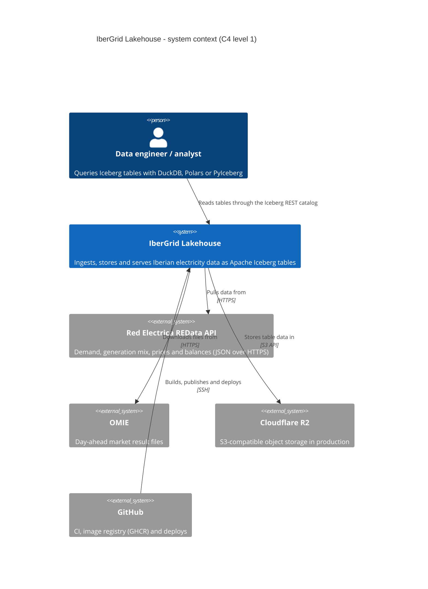
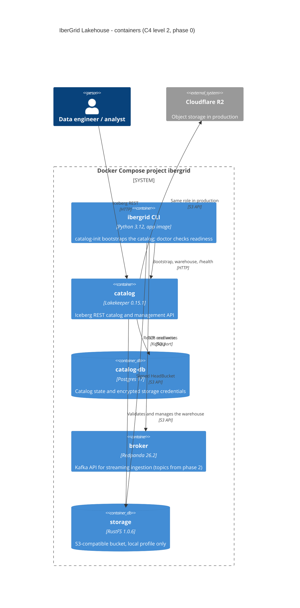

# Architecture

Phase 0 runs the storage, catalog and broker layers and the CLI that wires them together. The
pipelines (connectors, Dagster, streaming) build on these services in later phases. The decisions
behind the stack are in [ADR 0001](adr/0001-stack-and-scope.md).

## System context (C4 level 1)

## Containers (C4 level 2)

## Service inventory

| Container | Image (pinned by digest in `compose.yaml`) | Purpose | Networks | Local ports (127.0.0.1) |
|---|---|---|---|---|
| `storage` | `rustfs/rustfs:1.0.6` | S3 object storage; `local-storage` profile only | storage | 29000 (S3), 29001 (console at `/rustfs/console/`) |
| `storage-init` | `amazon/aws-cli:2.41.2` | One-shot: create the bucket (an existing one is fine) | storage | |
| `catalog-db` | `postgres:17-alpine` | Lakekeeper state; encrypted storage credentials | catalog-db (internal) | |
| `catalog-migrate` | `quay.io/lakekeeper/catalog:v0.15.1` | One-shot: `lakekeeper migrate` | catalog-db | |
| `catalog` | `quay.io/lakekeeper/catalog:v0.15.1` | `lakekeeper serve`: Iceberg REST catalog and management API | catalog-db, catalog, storage | 28181 |
| `catalog-init` | `ibergrid-app` (this repository) | One-shot: `ibergrid catalog bootstrap` | catalog | |
| `broker` | `docker.redpanda.com/redpandadata/redpanda:v26.2.2` | Kafka API, single node, dev-container mode | broker | 29092 (Kafka), 29644 (admin) |
| `doctor` | `ibergrid-app` (this repository) | On demand (scale 0): `ibergrid doctor` | storage, catalog, broker | |

Start-up order comes from `depends_on`: `storage` healthy, then `storage-init`; `catalog-db`
healthy, then `catalog-migrate`, then `catalog` healthy; then `catalog-init`. `docker compose up
--wait` returns once every long-running service is healthy and every one-shot has exited 0.

## Design notes

- **Least connectivity.** Each network groups the services that must talk to each other.
  Postgres sits on an `internal` network with no egress; only Lakekeeper reaches it. The catalog
  joins `storage` because it validates the warehouse location and manages files there.
- **Hardening.** Every container, one-shots included, runs with `no-new-privileges`, all
  capabilities dropped, a memory limit and a non-root user: RustFS as `rustfs` (10001), the AWS
  CLI as `nobody` (65534), Postgres as `postgres` (70), Lakekeeper as distroless `nonroot`
  (65532, set in compose because the image declares no user), Redpanda as `redpanda` (101) and
  the app as 10001.
- **Secrets.** Compose reads them from `.env` with `${VAR:?}` and no defaults, so a missing secret
  stops `docker compose` before anything starts. The app keeps them as `SecretStr` and its
  validation errors never echo input values.
- **Storage readiness.** `ibergrid doctor` sends a SigV4-signed `HEAD /<bucket>` instead of
  RustFS's anonymous `/health/ready`: the same check proves the endpoint, the keys and the bucket
  on RustFS and on Cloudflare R2, which has no health endpoint.
- **Catalog URI per client.** `LAKEKEEPER__BASE_URI` is left unset, so `/catalog/v1/config`
  advertises the address each client used: `http://127.0.0.1:28181/catalog` from the host and
  `http://catalog:8181/catalog` from containers.
- **No authentication yet (catalog and broker).** Lakekeeper runs without an identity provider, so
  its management API is open to whoever reaches port 8181. Redpanda runs in dev-container mode
  with unauthenticated Kafka and admin APIs. Locally both listen on 127.0.0.1 only; in production
  no port is published. Phase 2 hardens the broker, and authentication is a prerequisite for the
  public endpoints of phase 6.
- **One image for the CLI.** `catalog-init` and `doctor` run the same app image. In production it
  is pulled from GHCR by the digest the release job recorded: the image that job built, ran once
  (`ibergrid version`) and pushed. The server never builds anything.
- **Storage keys live in two places.** `catalog-init` stores the S3 keys in the warehouse when it
  creates it and never updates them. After rotating `IBERGRID_S3_*`, run
  `ibergrid catalog update-credential` (see `.env.example`).

## Environments

| | Local (`make up`) | Production (`compose.prod.yaml`) |
|---|---|---|
| Object storage | RustFS container (`local-storage` profile) | Cloudflare R2, `https://<account-id>.r2.cloudflarestorage.com`, region `auto` |
| App image | Built from source (`compose.override.yaml`) | `ghcr.io/jaisato/ibergrid-lakehouse@sha256:...`, digest in `release.env` |
| Env files | `.env` | `.env` (secrets, never written by the deploy) and `release.env` |
| Host ports | 127.0.0.1, 28xxx-29xxx | None |
| Restart policy | `on-failure` | `unless-stopped` |
| Logs | Docker defaults | `json-file`, 3 x 10 MB per container |
