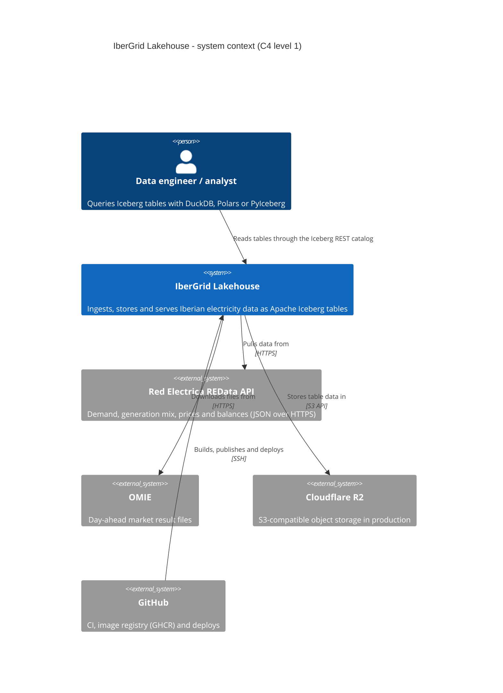

# Architecture

The stack runs the storage, catalog and broker layers and the CLI that wires them together; the
lake library (`ibergrid.lake`) writes and reads Iceberg tables on them, the phase-1 connectors
(`ibergrid.sources.redata` and `ibergrid.sources.omie`) ingest REData and OMIE into Bronze
through it, and Dagster (`ibergrid.orchestration`) runs the connectors as partitioned assets on
schedules and backfills; the streaming lane (`ibergrid.stream`) carries REData's five-minute
demand through Redpanda into Bronze, exactly once; and the dbt medallion (`ibergrid.transform` +
`dbt/`) builds and tests Silver and Gold tables in a staging DuckDB over snapshot-pinned Bronze
views and publishes them back to Iceberg through Write-Audit-Publish. The decisions behind the
stack are in [ADR 0001](adr/0001-stack-and-scope.md); who writes and who reads Iceberg, and how
Write-Audit-Publish works, in [ADR 0002](adr/0002-iceberg-write-and-read-paths.md); how REData is
ingested, in [ADR 0003](adr/0003-redata-ingestion.md), and OMIE, in
[ADR 0004](adr/0004-omie-ingestion.md); how both are orchestrated, in
[ADR 0005](adr/0005-dagster-orchestration.md); the streaming lane and the broker's security, in
[ADR 0006](adr/0006-streaming-lane.md); and the dbt Silver/Gold medallion, in
[ADR 0007](adr/0007-dbt-medallion.md).

## System context (C4 level 1)

## Containers (C4 level 2)

```mermaid
C4Container
  title IberGrid Lakehouse - containers (C4 level 2, phase 3)

  Person(analyst, "Data engineer / analyst")

  System_Boundary(stack, "Docker Compose project ibergrid") {
    Container(webserver, "dagster-webserver", "Dagster 1.13, orchestration image", "UI and GraphQL API: partitions, runs, backfills, medallion lineage")
    Container(daemon, "dagster-daemon", "Dagster 1.13, orchestration image", "Schedules, backfills, run queue with pools of 1, run monitoring")
    Container(code, "dagster-code", "Dagster 1.13, dbt Core, orchestration image", "Code server with ibergrid.orchestration; runs Bronze ingestion and Silver/Gold dbt+WAP transforms")
    ContainerDb(orchdb, "orchestration-db", "Postgres 17", "Runs, event logs (materializations and metadata), schedules")
    Container(app, "ibergrid CLI", "Python 3.12, PyIceberg, DuckDB, app image", "catalog-init bootstraps the catalog; doctor checks readiness and runs lake commands; ingest pulls REData and OMIE")
    Container(transform, "transform", "dbt Core 1.12, dbt-duckdb 1.11, orchestration image", "On-demand `ibergrid transform run`: builds and tests Silver/Gold in staging DuckDB and WAP-publishes to Iceberg")
    Container(catalog, "catalog", "Lakekeeper 0.15.1", "Iceberg REST catalog and management API")
    ContainerDb(catalogdb, "catalog-db", "Postgres 17", "Catalog state and encrypted storage credentials")
    Container(producer, "stream-producer", "Python 3.12, confluent-kafka, app image", "Polls the REData real-time demand every 5 min; emits changed points")
    Container(consumer, "stream-consumer", "Python 3.12, confluent-kafka, PyIceberg, app image", "Validates, deduplicates, dead-letters; WAP micro-batches with the offsets in the publish")
    Container(broker, "broker", "Redpanda 26.2", "Kafka API with SASL/SCRAM and ACLs: redata.demand.realtime.v1 and its DLQ")
    Container(brokerinit, "broker-init", "Redpanda 26.2 (rpk), one-shot", "Authentication, topics, users and ACLs")
    ContainerDb(storage, "storage", "RustFS 1.0.6", "S3-compatible bucket, local profile only")
  }

  System_Ext(r2, "Cloudflare R2", "Object storage in production")
  System_Ext(ree, "Red Electrica REData API", "Public JSON:API, no token")
  System_Ext(omie, "OMIE", "Daily marginalpdbc files, public downloads, no token")

  Rel(analyst, catalog, "Iceberg REST", "HTTP")
  Rel(analyst, webserver, "Materializes partitions, launches backfills", "HTTP, 127.0.0.1:28300 locally")
  Rel(webserver, code, "Loads definitions, launches runs", "gRPC")
  Rel(daemon, code, "Evaluates schedules, launches queued runs", "gRPC")
  Rel(webserver, orchdb, "Reads and writes", "SQL")
  Rel(daemon, orchdb, "Reads and writes", "SQL")
  Rel(code, orchdb, "Runs write their events", "SQL")
  Rel(code, ree, "REData assets: one run at a time, at most 1 request/s", "HTTPS")
  Rel(code, omie, "OMIE asset: one run at a time, at most 1 request/s", "HTTPS")
  Rel(code, catalog, "Iceberg REST (WAP)", "HTTP")
  Rel(code, storage, "Table data and landed raw answers and files", "S3 API")
  Rel(app, ree, "ingest redata: at most 1 request/s", "HTTPS")
  Rel(app, omie, "ingest omie: one file per delivery day, at most 1 request/s", "HTTPS")
  Rel(app, catalog, "Bootstrap, warehouse, Iceberg REST, /health", "HTTP")
  Rel(app, storage, "Table data and landed raw answers and files, with its own keys; HeadBucket", "S3 API")
  Rel(app, broker, "TCP readiness", "Kafka port")
  Rel(transform, catalog, "Reads Bronze snapshots; publishes Silver/Gold via WAP", "HTTP")
  Rel(transform, storage, "Reads Bronze Parquet; writes Silver/Gold Parquet", "S3 API")
  Rel(producer, ree, "demanda-tiempo-real, every 5 min, at most 1 request/s", "HTTPS")
  Rel(producer, broker, "Produces events as ibergrid-producer", "Kafka, SASL/SCRAM")
  Rel(consumer, broker, "Consumes; dead letters; group offsets for lag", "Kafka, SASL/SCRAM")
  Rel(consumer, catalog, "Iceberg REST (WAP, offsets as table properties)", "HTTP")
  Rel(consumer, storage, "Table data", "S3 API")
  Rel(brokerinit, broker, "Admin API and Kafka as the superuser", "HTTP, Kafka")
  Rel(catalog, catalogdb, "Reads and writes", "SQL")
  Rel(catalog, storage, "Validates and manages the warehouse", "S3 API")
  Rel(catalog, r2, "Same role in production", "S3 API")
```

## Service inventory

| Container | Image (pinned by digest in `compose.yaml`) | Purpose | Networks | Local ports (127.0.0.1) |
|---|---|---|---|---|
| `storage` | `rustfs/rustfs:1.0.6` | S3 object storage; `local-storage` profile only | storage | 29000 (S3), 29001 (console at `/rustfs/console/`) |
| `storage-init` | `amazon/aws-cli:2.41.2` | One-shot: create the bucket (an existing one is fine) | storage | |
| `catalog-db` | `postgres:17-alpine` | Lakekeeper state; encrypted storage credentials | catalog-db (internal) | |
| `catalog-migrate` | `quay.io/lakekeeper/catalog:v0.15.1` | One-shot: `lakekeeper migrate` | catalog-db | |
| `catalog` | `quay.io/lakekeeper/catalog:v0.15.1` | `lakekeeper serve`: Iceberg REST catalog and management API | catalog-db, catalog, storage | 28181 |
| `catalog-init` | `ibergrid-app` (this repository) | One-shot: `ibergrid catalog bootstrap` | catalog | |
| `broker` | `docker.redpanda.com/redpandadata/redpanda:v26.2.2` | Kafka API, single node; dev-container mode locally, production mode in `compose.prod.yaml`; SASL/SCRAM and ACLs | broker | 29092 (Kafka, SASL/SCRAM) |
| `broker-init` | `docker.redpanda.com/redpandadata/redpanda:v26.2.2` | One-shot: SCRAM users, authentication, cluster policy, topics and ACLs (idempotent) | broker | |
| `doctor` | `ibergrid-app` (this repository) | On demand (scale 0): `ibergrid doctor`; also runs `ibergrid lake ...` | storage, catalog, broker | |
| `ingest` | `ibergrid-app` (this repository) | On demand (scale 0): `ibergrid ingest ...`, with a 384 MiB memory limit | storage, catalog | |
| `transform` | `ibergrid-orchestration` (this repository) | On demand (scale 0): `ibergrid transform run` (`make transform`), 1.25 GiB limit | storage, catalog | |
| `stream-producer` | `ibergrid-app` (this repository) | `ibergrid stream produce` (`stream` profile locally); no lake keys; 256 MiB | broker | |
| `stream-consumer` | `ibergrid-app` (this repository) | `ibergrid stream consume` (`stream` profile locally); 384 MiB | broker, catalog, storage | |
| `orchestration-db` | `postgres:17-alpine` | Dagster's runs, event logs and schedules | orchestration-db (internal) | |
| `orchestration-migrate` | `ibergrid-orchestration` (this repository) | One-shot: `dagster instance migrate` | orchestration-db | |
| `dagster-code` | `ibergrid-orchestration` (this repository) | `dagster code-server start`: the definitions; runs execute here (1.5 GiB limit) | orchestration, orchestration-db, storage, catalog | |
| `dagster-webserver` | `ibergrid-orchestration` (this repository) | `dagster-webserver`: UI and GraphQL | orchestration, orchestration-db, orchestration-ui (local only) | 28300 |
| `dagster-daemon` | `ibergrid-orchestration` (this repository) | `dagster-daemon run`: schedules, backfills, run queue, run monitoring | orchestration, orchestration-db | |

Start-up order comes from `depends_on`: `storage` healthy, then `storage-init`; `catalog-db`
healthy, then `catalog-migrate`, then `catalog` healthy; then `catalog-init`; `orchestration-db`
healthy, then `orchestration-migrate`; both one-shots done, then `dagster-code` healthy; then
`dagster-webserver` and `dagster-daemon`; `broker` healthy, then `broker-init`, which `doctor`
and the stream services wait for (the consumer also for `catalog-init`). `docker compose up
--wait` returns once every long-running service is healthy and every one-shot has exited 0.

## Design notes

- **Least connectivity.** Each network groups the services that must talk to each other.
  Postgres sits on an `internal` network with no egress; only Lakekeeper reaches it. The catalog
  joins `storage` because it validates the warehouse location and manages files there. Dagster's
  Postgres and gRPC networks are internal too; only `dagster-code`, where runs execute, joins
  `storage` and `catalog` (and so has egress to the sources) and holds the lake's keys. Locally the
  webserver also joins `orchestration-ui`, because Docker publishes no port through an internal
  network. The stream producer joins only `broker` (which has egress, for REData) and holds no
  lake keys; the consumer joins `broker`, `catalog` and `storage`.
- **Hardening.** Every container, one-shots included, runs with `no-new-privileges`, all
  capabilities dropped, a memory limit and a non-root user: RustFS as `rustfs` (10001), the AWS
  CLI as `nobody` (65534), Postgres as `postgres` (70), Lakekeeper as distroless `nonroot`
  (65532, set in compose because the image declares no user), Redpanda as `redpanda` (101) and
  the app and orchestration images as 10001.
- **Secrets.** Compose reads them from `.env` with `${VAR:?}` and no defaults, so a missing secret
  stops `docker compose` before anything starts. The app keeps them as `SecretStr` and its
  validation errors never echo input values.
- **Storage readiness.** `ibergrid doctor` sends a HeadBucket through pyarrow's S3 client
  instead of RustFS's anonymous `/health/ready`: the same check proves the endpoint, the keys and
  the bucket on RustFS and on Cloudflare R2, which has no health endpoint.
- **Lake access ([ADR 0002](adr/0002-iceberg-write-and-read-paths.md)).** PyIceberg writes,
  always to a run's audit branch, and publishes; DuckDB reads, queries metadata and compacts.
  Lakekeeper hands every client the warehouse's in-network endpoint (`http://storage:9000`) and
  no credentials, and the warehouse has remote signing off, so each client applies its own
  `IBERGRID_S3_*` endpoint and keys: the same code runs in containers and from the host. The app
  image bakes DuckDB's extensions at build time and never downloads them at runtime.
- **Ingestion ([ADR 0003](adr/0003-redata-ingestion.md)).** `ibergrid ingest redata` runs in
  the `ingest` one-shot, whose networks have egress to the public API. Per chunk (a dataset, a
  system and a calendar month or year of local days) it fetches, checks the structure, lands the
  raw answer under `landing/` in the bucket (outside the warehouse prefix) and publishes the rows
  to `bronze.redata_observations` through Write-Audit-Publish, replacing exactly that window. It
  has a 384 MiB memory limit, since a month of five-minute demand peaks at 238 MiB; the other app
  one-shots keep 192 MiB.
- **OMIE ([ADR 0004](adr/0004-omie-ingestion.md)).** `ibergrid ingest omie` runs in the same
  one-shot. Per chunk (a calendar month of delivery days) it downloads one file per day (its
  current version: `.1`, or the `.2`/`.3` OMIE republished it as), checks each against its
  contract version (hourly until 2025-09-30, quarter-hourly from 2025-10-01),
  lands the original files under `landing/omie/` and publishes the rows to
  `bronze.omie_day_ahead_prices` through Write-Audit-Publish, replacing exactly those delivery
  days. It stops at the first day OMIE has not published yet, with exit 0 or, with
  `--require-published`, exit 1. A month peaks at 114 MiB.
- **Catalog URI per client.** `LAKEKEEPER__BASE_URI` is left unset, so `/catalog/v1/config`
  advertises the address each client used: `http://127.0.0.1:28181/catalog` from the host and
  `http://catalog:8181/catalog` from containers.
- **No authentication on the catalog yet.** Lakekeeper runs without an identity provider, so its
  management API is open to whoever reaches port 8181; locally it listens on 127.0.0.1 only, and
  in production no port is published. Authentication is a prerequisite for the public endpoints
  of phase 6.
- **Broker security ([ADR 0006](adr/0006-streaming-lane.md)).** SASL/SCRAM on every Kafka
  listener in every environment; one user per service with least-privilege ACLs
  (`ibergrid-producer` writes the data topic; `ibergrid-consumer` reads it, writes the DLQ and
  commits its group); the superuser `ibergrid-admin` is used by `broker-init` only; the admin API
  requires it and is not published; the unauthenticated HTTP Proxy (8082) and Schema Registry
  (8081) do not start; topics are never created on demand. No TLS yet: plaintext on the Docker
  networks.
- **Streaming ([ADR 0006](adr/0006-streaming-lane.md)).** The consumer writes WAP micro-batches
  whose publish commits the checkpoint (the topic's id and the next offsets) as a table property,
  and resumes from that property: exactly once into `bronze.redata_demand_stream` without Kafka
  transactions; it refuses a topic that changed under the checkpoint until `ibergrid stream
  reset`, and expires its table's snapshots daily. Both stream services beat a heartbeat file with
  their failure streak; their healthchecks run `python -m ibergrid.stream.health` (standard
  library only) because the full CLI costs 133 MiB per start inside the service's own memory
  limit, and a watchdog ends a process whose loop is stuck so that its restart policy recovers it.
- **Two images, one Dockerfile.** `catalog-init`, `doctor`, `ingest` and the stream services run
  the app image (813 MB: no Dagster, no dbt); the Dagster services and the on-demand `transform`
  runner use the orchestration image (`--target orchestration`, 1.44 GB: the same environment plus
  Dagster, dbt Core, `dbt-duckdb`, `/opt/ibergrid/dbt`, `dagster.yaml` and `workspace.yaml`). In
  production both are pulled from GHCR by the digests the release job recorded: the images that job
  built, ran once (`ibergrid version`; the Dagster definitions validated) and pushed. The server
  never builds anything.
- **Medallion transforms ([ADR 0007](adr/0007-dbt-medallion.md)).** Because DuckDB 2.0.1 cannot
  write Iceberg branches or guard `main` (ADR 0002), `ibergrid.transform` runs `dbt build` in an
  ephemeral staging DuckDB file wired via a `dbt-duckdb` plugin (`ibergrid.transform.plugin`) that
  reuses `ibergrid.lake.duck.configure`, sets `GLOBAL TimeZone = 'UTC'` across all cursors, and
  exposes every Bronze table pinned to its `main` snapshot (or an empty typed table when a table
  has no snapshot yet). Any failing model or dbt test aborts before any Iceberg branch is opened;
  only after all models and tests pass does PyIceberg publish each selected Silver and Gold table
  through `ibergrid.lake.wap`, recording the Bronze snapshot provenance in every snapshot summary.
  Dagster exposes all 9 Silver and Gold tables as a subsettable `@multi_asset` in the `transform`
  pool (limit 1) with daily Madrid schedules at 09:30 and 16:30.
- **Orchestration ([ADR 0005](adr/0005-dagster-orchestration.md)).** Runs execute as subprocesses
  of `dagster-code` (the default run launcher: no Docker socket anywhere), whose memory limit
  covers them. The daemon launches a queued run only when its pool (`redata`, `omie`, limit 1) is
  free. Run metadata, materializations and schedule ticks live in `orchestration-db`; compute
  logs in a volume written by `dagster-code` and read by the webserver. A stop of `dagster-code`
  waits up to 5 minutes (`stop_grace_period`) for its runs to end; a run killed anyway holds its
  pool until run monitoring fails it after 2 hours (then it is queued again), and the daily
  sweeper frees its audit branches. Healthchecks run every 60 s (every 5 s while a service starts): each one starts a
  Python process. The deploy runs `lake init` before `up`, so the schedules never meet missing
  tables.
- **Storage keys live in two places.** `catalog-init` stores the S3 keys in the warehouse when it
  creates it and never updates them. After rotating `IBERGRID_S3_*`, run
  `ibergrid catalog update-credential` (see `.env.example`), which also resets the storage-profile
  fields ibergrid owns and keeps the others: that is how a warehouse created before ADR 0002 gets
  remote signing turned off.

## Environments

| | Local (`make up`) | Production (`compose.prod.yaml`) |
|---|---|---|
| Object storage | RustFS container (`local-storage` profile) | Cloudflare R2, `https://<account-id>.r2.cloudflarestorage.com`, region `auto` |
| App image | Built from source (`compose.override.yaml`) | `ghcr.io/jaisato/ibergrid-lakehouse@sha256:...`, digest in `release.env` |
| Orchestration image | Built from source (`--target orchestration`) | `ghcr.io/jaisato/ibergrid-lakehouse-orchestration@sha256:...`, digest in `release.env` |
| Dagster schedules | Stopped (start them in the UI) | Running (`IBERGRID_ORCHESTRATION_SCHEDULES_RUNNING`) |
| Streaming lane | `stream` profile, started by `make stream-up` | Running |
| Broker mode | Dev-container (fsync bypassed); SASL/SCRAM and ACLs | Production mode (fsync, startup checks); SASL/SCRAM and ACLs |
| Env files | `.env` | `.env` (secrets, never written by the deploy) and `release.env` |
| Host ports | 127.0.0.1, 28xxx-29xxx (Dagster UI 28300) | None |
| Restart policy | `on-failure` | `unless-stopped` |
| Logs | Docker defaults | `json-file`, 3 x 10 MB per container |
